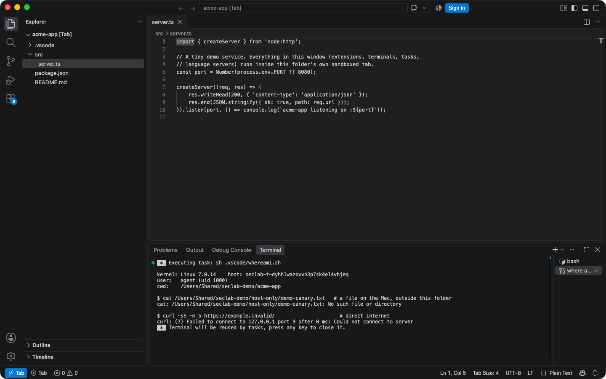
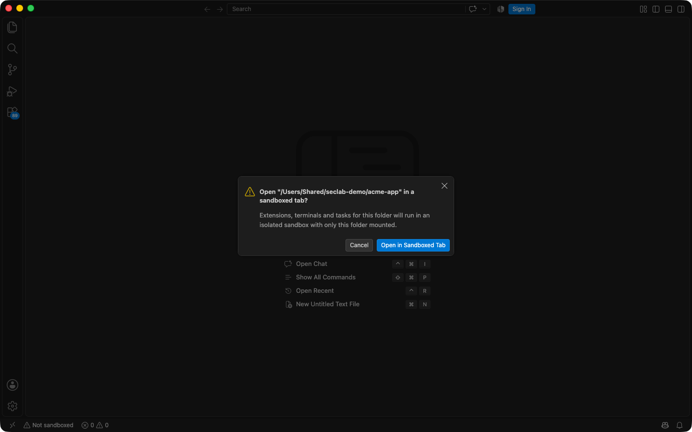
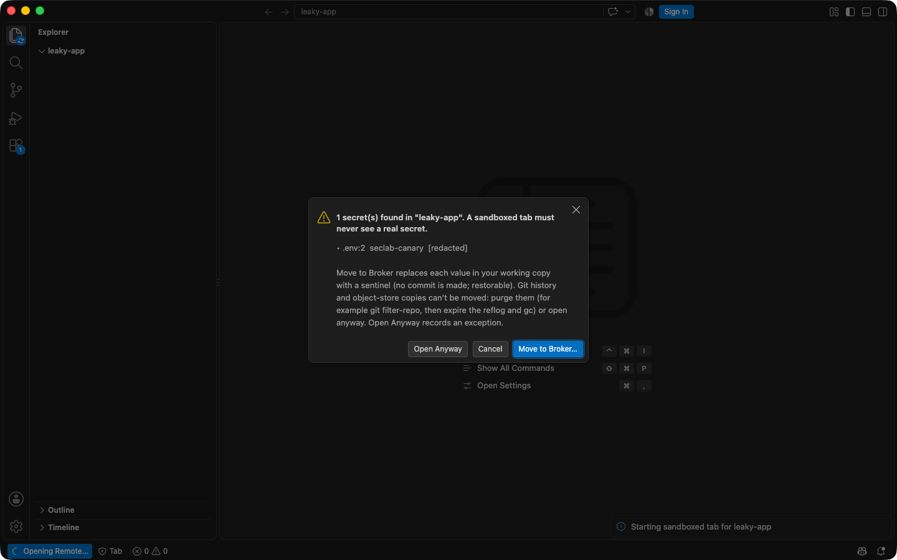
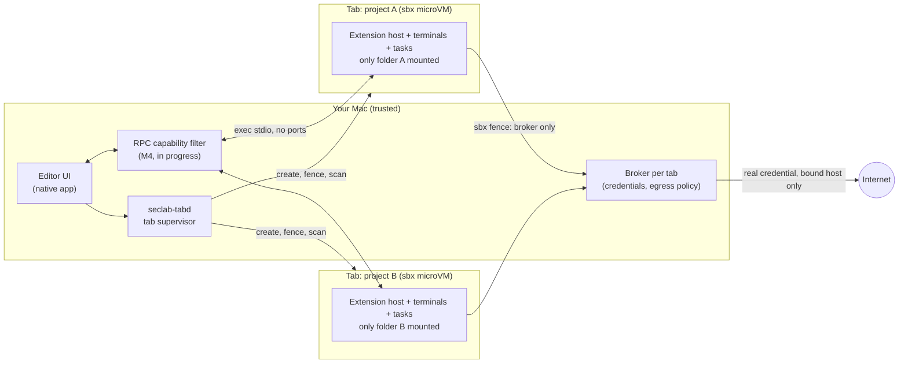

# seclab-vscode

**VS Code with Chrome-style tab isolation: a rogue extension can only damage the tab it's in.**



<sub>A real window from our build. The folder's own task ran on open: inside the tab it is
Linux in an sbx microVM, as user `agent`. A file on the Mac outside the folder doesn't
exist there, and direct internet access fails.</sub>

## Why

- Today every VS Code extension, task, linter config and git hook runs with **your**
  user privileges. It can reach your SSH keys, cloud tokens, browser sessions and
  every other project on the machine.
- Workspace Trust is a prompt, not a security boundary: one click and a repository's
  tasks, hooks and extensions run unsandboxed.
- seclab-vscode treats each window like a browser tab. Everything that runs for a
  folder runs in **that folder's own sandbox**, and secrets stay outside it.

## Use cases

| | Use case | Today |
|---|---|---|
| 🧩 | **Try an unknown extension safely.** Every extension runs in the window's tab sandbox, including ones that ask to run "locally". It can't read other projects, `~/.ssh` or the keychain. | ✅ Works ([hero shot](docs/media/tab-hero.png)) |
| 🤖 | **Agentic features in a sandboxed tab.** VS Code's built-in chat and agent tools are **turned off** in sandboxed windows, not contained. The chat agent runs in the trusted workbench, so a repo that writes `.github/instructions/` steers it into host-side tools without making a single sandboxed call. | 🔴 Disabled in tabs, by design ([ADR](docs/adr/20261105-no-builtin-chat-in-tabs.md)). **A related gap is still open:** a workspace setting can make the host dial an attacker's agent host; the patch for it is on a follow-up branch and not in this build. Containing this class, rather than withdrawing it, is a separate workstream. |
| 📦 | **Open an untrusted repository.** Malicious `tasks.json` folder-open tasks, `core.fsmonitor` git hooks, `eslint.config.js` and interpreter-path settings all execute inside the tab, not on your Mac. | ✅ Works (containment suite, sbx and OCI) |
| 🎣 | **Open a recruiter's "take-home" repo.** The DPRK "Contagious Interview" campaign hides a folder-open task that pipes a fetched script into `node`. Here, automatic tasks stay off. If the task runs anyway, it runs in the tab: its fingerprinting sees the tab, its beacons and IP lookups are denied, your wallets and keychain aren't there, its persistence stays in the tab's home (and **Reset tab** clears it). [Worked example](docs/adr/20261104-threat-model-rogue-extension.md#worked-example-contagious-interview-tasksjson-abuse-2026-11-04). | ✅ Works · 🟡 hooks it plants in the repo are held by the write-back gate (in progress) |
| 🔑 | **Catch secrets in a folder before it opens.** The folder is scanned with gitleaks (worktree, git history, object store, archives) **before** it's mounted. Each secret can be moved to the broker (the file keeps a sentinel) or accepted with a recorded exception. | ✅ Works ([screenshot](#screenshots)) |
| 👁️ | **Watch what a tab does.** Every tab streams its process launches, connections, honeypot reads, workspace writes and egress decisions into a "Tab Activity" panel and a per-tab log, with rules for folder-open loaders, beacons and credential theft. Each event says how far you can trust it, and a killed sensor shows the tab as *unobserved*. | ✅ Works on sbx and OCI (`./seclab test obs`, [screenshot](#screenshots)) |
| 🚨 | **Get told when a tab does something malicious.** A loader run by a folder-open task, a credential honeypot read, a planted git hook, an ungated agent connection or a blinded sensor raises one plain-language notification. It names the tab, shows the process chain and how far to trust it, and offers **Stop Tab**, **Open Activity**, **Review Held Changes** and, for egress, **Block Destination** (a broker deny rule for that tab, which also refuses a request waiting on a prompt). A flood stays one notification with a count. A **Detections** view lists them across all tabs, including stopped ones. | ✅ Works (`node test/observability/notify-e2e.ts`, [screenshot](#screenshots); Block: `./seclab test obs oci`) |
| 🎟️ | **Use tokens without exposing them.** The tab only ever holds placeholder credentials. The broker swaps in the real value on the way out, only for the host it's bound to, so `git fetch` still works. | 🟡 Broker built and tested; wiring into tabs is in progress. *TODO: screenshot.* |
| 🌐 | **Control which domains each project can reach.** Egress is default-deny per tab, and a new destination raises a "Tab X wants to reach host Y" prompt. | 🟡 Broker built and tested; prompt UI in progress. *TODO: screenshot.* |
| ☁️ | **Same model locally or in the cloud.** Tabs run in Docker Sandboxes (sbx) microVMs on the Mac, or as OCI containers on Linux and CI. A Kubernetes driver is planned. | ✅ sbx + OCI · ⏳ Kubernetes |

## Screenshots

| Opening a folder | Secrets found before mount |
|---|---|
|  |  |
| A local folder never opens unsandboxed. The plain window closes and a trusted prompt offers the tab. | gitleaks runs in a throwaway, network-less container before the folder is mounted. Values are never shown. |

| Watching a tab |
|---|
|  |
| An inert folder-open loader runs in a real sbx tab. Detections appear live, each labelled with its integrity: "tab VM root" for the in-tab sensor, "trusted" for sbx and the write-back gate. The beacon address is a documentation IP (RFC 5737). |

| Told when a tab does something malicious |
|---|
| ![Two notifications in the "take-home-exercise" tab window. An error notification reads: Tab "take-home-exercise": A process downloaded code and ran it straight away. Chain: "seclab-reh-start → sh → node → node → bash" (seen inside the tab's VM; root in the tab could fake it). Piping a download into an interpreter is how loaders deliver malware. Its buttons are Stop Tab, Open Activity and Dismiss. Above it, the write-back gate's warning says the tab changed 1 file that can run code on your machine and holds it for review. The status bar shows "1 held" and "Observed".](docs/media/notifications.png) |
| The inert Contagious-Interview fixture's folder-open loader runs in a real sbx tab (`node test/observability/notify-e2e.ts`). The notification's wording is a trusted template. Text the tab chose appears only in quotes, with its integrity spelled out. The window was launched in the background and captured while covered. |

## How it works



- **The tab is the boundary.** Each window runs in its own microVM (sbx) or container
  (OCI), with only its folder mounted, no host secrets and no route to other tabs.
- **The editor UI is the trusted "browser".** It stays native, and VS Code's
  remote-extension-host split runs everything else inside the tab.
- **One small supervisor (`seclab-tabd`)** owns tab identity, runtime drivers, the
  network fence and pre-mount scanning. It's a JSON-RPC process over stdio, so it has
  no listener.
- **No real secret ever enters a tab.** The broker holds credentials, and tabs see
  sentinels plus a per-tab proxy password.
- **Fail closed:** the sbx fence lets a tab reach only its broker, and a drifted
  policy stops the tab.

Details: [docs/ARCHITECTURE.md](docs/ARCHITECTURE.md).

## Status

| Milestone | What | State |
|---|---|---|
| M0 | Fork build: pinned Code-OSS, product.json applied as data, a small patch queue, an unsigned macOS app built on GitHub Actions | ✅ |
| M1 | Every folder opens as a sandboxed tab (sbx primary, OCI second), with no host ports; containment suite on both drivers | ✅ |
| M1+ | Pre-mount secret scanning (gitleaks), reviewed until no medium-or-higher findings remained | ✅ |
| M2–M3 | Broker: per-tab egress policy, credential sentinels, approval prompts | 🟡 Built and tested standalone ([broker/](broker/)). OCI tabs run behind their broker with default deny ([EDR](docs/edr/20261105-oci-tab-broker.md)); sbx, prompts and credentials are in progress ([plan](docs/plans/tabd-broker-wiring.md)) |
| M4 | RPC capability filter between the UI and the tab | 🟡 In progress. **Server-initiated pushes stay open:** a hostile REH can still reach host code execution via `remoteTerminal.$onExecuteCommand`, and read the host shell environment (`${env:GITHUB_TOKEN}`) via `$onPtyHostRequestResolveVariablesEvent`. Patches refusing both exist on a follow-up branch but are held back: the rogue-REH fixture has never been runnable, so neither refusal has a runtime proof, and nothing unproven ships. **Other known gaps:** an extension in a tab can read user settings and the clipboard through the extension API, and git's askpass can reach the UI's auth providers. The editor-driven test run marks these as known gaps (XFAIL). |
| M4a | Trusted-side AI surfaces (built-in chat, agent tools, agent-host protocol) | 🔴 **Not contained**, and partly **not yet in effect.** Built-in chat is disabled in sandboxed windows ([ADR](docs/adr/20261105-no-builtin-chat-in-tabs.md)), but the agent-host **dial path is still open**: patch 0011, which closes it, is held on a follow-up branch so the core RPC filter can land first. See [re-review](docs/security-reviews/20261105-rpc-filter-rereview.md). The surface is enumerated and pinned by the drift gate, but its probes are **not implemented** — nothing has been proven against an unpatched baseline, so nothing here is tested containment. |

Threat model: a **rogue extension** the user installs, with full control of its tab.
Kernel and hypervisor escapes are out of scope; the microVM is defence in depth.

## Quick start

> You need Docker, `gh` and, on macOS,
> [Docker Sandboxes](https://docs.docker.com/ai/sandboxes/) (`sbx`). Nothing else is
> installed on the host.

```sh
# macOS: fetch the unsigned app built by GitHub Actions from main. It verifies the
# checksums and the build provenance attestation before extracting; then clear quarantine.
./seclab fetch macos
xattr -dr com.apple.quarantine .work/app/seclab-vscode.app

# run it with a separate profile; opening a folder routes it into a sandboxed tab
.work/app/seclab-vscode.app/Contents/Resources/app/bin/code --user-data-dir ~/.seclab-test/demo /path/to/project

# build from source (all in containers)
./seclab build linux        # VS Code server (REH) for the tab, from pinned upstream
./seclab template sbx       # sbx tab template
./seclab image oci          # OCI tab images and the tab broker (both drivers need it)

# tests
./seclab test containment sbx   # malicious-workspace vectors inside real tabs (also: oci)
./seclab test secrets sbx       # pre-mount secret scan, move-to-broker, restore
broker/test.sh                  # broker unit + integration
```

## Docs

- [Architecture](docs/ARCHITECTURE.md): the current design, threat model and milestones.
- [Architecture decision records](docs/adr/) and [engineering decision records](docs/edr/).
- [Security reviews](docs/security-reviews/): every round, with findings and fixes.
- [AGENTS.md](AGENTS.md): how to work in this repo (rules, commands, gotchas).
- [Research](docs/research/): VS Code internals, sandbox runtimes, workspace exec vectors.
- [Broker protocol](docs/broker-protocol.md).
- [Original idea](raw-idea.md).
