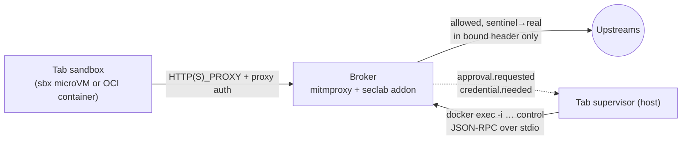

# seclab-vscode broker

The per-tab egress and credential broker (milestones M2 and the broker side
of M3 in [ARCHITECTURE.md §6](../docs/ARCHITECTURE.md#6-prototype-milestones-each-one-is-a-working-demo)).
It is a [mitmproxy](https://github.com/mitmproxy/mitmproxy/tree/51c1d6b2d8d3367a773411eb7a3eeccec82b3ea7)
12.3.1 container with our addon. Everything a tab sends off the tab goes
through it.
- **Default deny.** Requests are allowed only by policy or by a user decision.
  A request that is denied is held while the user is asked, then resumed, with
  no retry needed.
- **Sentinel credentials.** Credentials are sentinels everywhere except in the
  one header a binding names, on a matching request.
- **No real or derived secret ever reaches the tab.**

## Quick start
```sh
broker/build.sh                 # builds seclab-broker:dev
broker/test.sh                  # unit tests (in the image, --network none) + pod-shaped integration suite
broker/tests/sbx/validate.sh    # optional: real sbx 0.51 fence + broker chaining (needs sbx)
```
- **Protocol:** [docs/broker-protocol.md](../docs/broker-protocol.md).
- **Policy schema:** [schema/policy.v1.schema.json](schema/policy.v1.schema.json),
  with examples in [examples/](examples/).
- **Agent notes:** [AGENTS.md](AGENTS.md).

## Design in one screen



**The policy is engine-agnostic.** [`policy.py`](seclab_broker/policy.py)
contains the schema, normalisation, the matcher and the provider backstop, and
imports nothing from mitmproxy. [`core.py`](seclab_broker/core.py) holds state,
approvals and control methods. [`engine_mitmproxy.py`](seclab_broker/engine_mitmproxy.py)
is the only file that knows mitmproxy. Replacing the engine with smokescreen or
Envoy means writing a new adapter that produces a `RequestView` and honours the
same decisions ([EDR](../docs/edr/20261104-broker-engine-mitmproxy.md)).

**The request path:**
1. **Proxy auth.** Requests with missing or wrong credentials get `407` and
   nothing else happens.
2. **Request view.** The broker canonicalises the request and rejects any
   disagreement between Host, SNI, `:authority`, the absolute-form authority
   and the CONNECT target. It also rejects non-canonical paths and
   method-override headers or parameters.
3. **Allow rule, or hold and prompt.** If no allow rule matches, the request is
   held with `flow.intercept()` while `approval.requested` goes out, then
   `resume()`d.
4. **Sentinels.** The broker finds every sentinel occurrence: raw or base64, in
   headers, URL, body or trailers. Each one either matches a binding (the named
   header, on a matching host, path and method, over HTTPS) or is misplaced.
   Misplaced sentinels are blocked and audited.
5. **Provider backstop.** It denies credentialed calls to endpoints that mint
   durable credentials.
6. **JIT.** If the value is missing, the broker waits for `credential.provide`.
7. **Injection.** The broker writes the real value into the named header only.
8. **Upstream guard.** The broker resolves the name itself, refuses non-public
   and broker-local addresses (including IPv4-mapped, 6to4, NAT64 and Teredo
   forms), and pins the vetted IP.

**The response path:**
1. Raw echoes of a real value become the sentinel. Any other encoding (base64,
   hex, URL or JSON) blocks the response.
2. On credentialed flows and bound hosts, tokens the upstream mints are
   re-sentinelised as derived credentials with the parent's bindings, or
   redacted. The rules come from gitleaks plus generic JSON and form token
   fields.
3. Session headers (`Set-Cookie` and others) on credentialed flows are
   stripped.
4. Server WebSocket frames are scanned in the same way, and client frames that
   carry sentinels are dropped.

Decision records:
- **ADRs:** [policy and protocol](../docs/adr/20261104-broker-policy-and-control-protocol.md),
  [no real secret enters a tab](../docs/adr/20261104-no-real-secret-enters-a-tab.md).
- **EDRs:** [engine](../docs/edr/20261104-broker-engine-mitmproxy.md),
  [sentinels](../docs/edr/20261104-sentinel-format-and-binding.md),
  [CA](../docs/edr/20261104-broker-per-tab-ca.md),
  [DNS](../docs/edr/20261104-internal-network-dns-exfiltration.md),
  [sbx chaining](../docs/edr/20261104-broker-behind-sbx-fence.md).
- **Security review:** [20261104-broker-m2-m3](../docs/security-reviews/20261104-broker-m2-m3.md).

## Engine capability matrix

The Tab Manager and supervisor must check `broker.hello.capabilities` and
degrade explicitly; they must never assume a guarantee.

| Capability | mitmproxy broker, OCI pod | mitmproxy broker behind sbx fence | sbx native proxy (fallback only) |
|---|---|---|---|
| Default deny | yes | yes (broker); sbx fence denies everything but the broker port | yes |
| Hold and resume while prompting | yes (`intercept`/`resume`) | yes | no: sbx 0.51 denies; the client must retry after `sbx policy allow` |
| Credential bound to host + **path + method** | yes | yes | **no**: `secret set-custom --host` is host-only, so a gist POST to an allowed github.com gets the real token |
| Injection only into the named header | yes | yes | not documented |
| Response scanning and minted-token re-sentinelisation | yes | yes | no |
| Provider backstop deny-list | yes | yes | no |
| Per-tab CA (ours, private key only in the broker) | yes | yes | sbx's own CA |
| HTTP/2, WebSocket | yes (tested) | yes (HTTP/2 tested through sbx) | yes (per sbx docs) |
| DNS control | tab has no resolver for external names (embedded DNS does not forward on `--internal`, tested) | sbx DNS proxy blocks lookups not allowed by policy (tested) | sbx DNS proxy |
| Runtime-mutable policy | yes (`policy.update`, `allow-tab`) | yes | yes (`sbx policy allow`) |
| Proxy auth per tab | yes | yes (required: the loopback port is reachable by any local process) | n/a |
| Isolation domain between broker (real secrets) and tab | **weaker**: separate containers, **shared kernel** | **strong**: tab in a microVM, broker in Docker Desktop's VM | sbx host proxy |

## Deviations from ARCHITECTURE.md, and why

1. **Control channel bridging.** The control channel is JSON-RPC over the stdio
   of a `seclab-broker control` process started by `docker exec -i`, which
   bridges to a private Unix socket in the broker. It is not the stdio of the
   proxy process itself. *Why:* the supervisor can reconnect after a crash or
   restart without restarting the broker, and more than one client can attach.
   It still holds that nothing listens on the host.
2. **Under sbx, the broker is a container published on `127.0.0.1:P`, not a pod
   sidecar.** This follows the [single-broker ADR](../docs/adr/20261104-single-broker-sbx-fence.md).
   As a consequence, **per-tab proxy auth** is added (128-bit, constant-time,
   delivered over stdio), because any local process can reach the port.
3. **Credentials need both an allow rule and a binding**, as in the Deno
   Sandbox model. A binding does not imply egress.
4. **Placement-only injection, response scanning, minted-token handling,
   session stripping, the provider backstop and credential import** go beyond
   §4.5. They come from the user's decision that no real **or derived** secret
   ever enters a tab ([ADR](../docs/adr/20261104-no-real-secret-enters-a-tab.md)).
5. **Upstream address guard.** It is not in §4.4. It came from a security
   review: the broker never connects to non-public or broker-local addresses,
   even for an allowed hostname.
6. **The baseline** is the Open VSX gallery only (read-only). Package
   registries are opt-in per tab.
7. **Egress prompts are per origin** (`scheme://host:port`), so a page load
   doesn't produce dozens of prompts. Credential-binding prompts are per exact
   request shape.

## Open issues
- **Connection reuse.** Pinning the vetted IP into `server.address` disables
  mitmproxy's upstream connection reuse across requests on one client
  connection. This is correct but slower (a TLS handshake per request).
- **Body buffering.** The broker buffers whole bodies (no streaming), up to
  `SECLAB_BODY_SIZE_LIMIT`. Large git packs cost memory.
- **Cookie-bound credentials.** When the inject header is `Cookie`, the broker
  overwrites the whole header with that one cookie.
- **Proxy-auth rotation** does not tear down established WebSockets.
- **CA constraints.** The CA is not name-constrained. A pinned-certificate
  client must be denied or given a non-MITM path.
- **Gateway detection.** The address guard treats the first host address of
  each directly connected subnet as a Docker gateway. Supervisors must not use
  custom `--gateway` values.
- **Intra-tab replay.** Any process in the tab that knows a sentinel can use it
  through its binding. That is the accepted per-tab blast radius; see
  ARCHITECTURE §8 for per-extension attribution.
- **Unparsed Rails `_method` in bodies.** On github.com web endpoints, `_method`
  in a form body is not parsed. Bindings should name git/API paths only.
- **Endpoints outside the backstop.** Out of scope: a tab with repo write
  access pushing a workflow that exfiltrates repository secrets via Actions.
  This needs server-side controls (token scopes).
