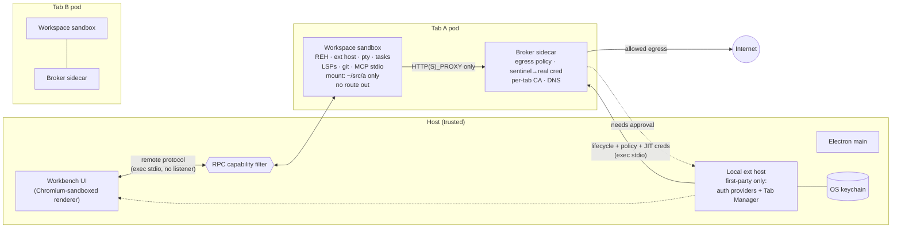

# seclab-vscode: Browser-Style Containment for the VS Code Editor

**Status:** v0.2 (2026-11-04). M0 and M1 are built; see "As built" below. The rest is the design. Each section links the ADRs behind it ([index](adr/README.md)); engineering decisions and spike results are in [docs/edr/](edr/README.md), and security reviews in [docs/security-reviews/](security-reviews/README.md).
**Goal:** Contain a rogue extension, or any code a workspace can make run, to one **tab** by default. A tab is one workspace window, analogous to a site in Chrome. The front-end experience stays the same.

### As built (M0/M1), and how it differs from the original proposal
- **Native editor.** The trusted editor runs natively on macOS. It is an unsigned darwin-arm64 build from the pinned upstream, made on GitHub Actions ([ADR](adr/20261104-native-editor-on-actions.md)). The Linux container build produces the REH and runs CI. There is no containerised editor and no host bridge.
- **Tab supervisor.** `seclab-tabd` sits between the editor and the runtimes, speaking a versioned stdio protocol ([ADR](adr/20261104-tab-supervisor.md), [protocol](tabd/PROTOCOL.md)). The Tab Manager extension is now only the resolver, the routing and the UI.
- **Drivers.** sbx is the primary runtime (one microVM per tab); OCI is the second ([ADR](adr/20261104-pluggable-sandbox-provider.md), superseded by the supervisor ADR for the interface).
- **Egress fence and broker.** Under sbx, the per-tab sbx policy is an outer fence. It allows only that tab's broker, mirrors every global allow as a per-tab deny, re-verifies on every connect and every 60 s, and fails closed ([ADR](adr/20261104-single-broker-sbx-fence.md), [EDR](edr/20261104-sbx-fence-spike.md)). Our broker is the only engine.
- **Extension placement.** Every non-built-in extension is forced into the tab, and nothing extension-based runs in local windows (patches 0002–0004; [ADR](adr/20261104-extension-placement-hardening.md)).
- **Pre-mount secret scan.** Before a folder is mounted into a tab, gitleaks scans it (the worktree, every git dir, history, the object store and archives) in a network-less container. Findings block the open until each one is moved to the broker vault or accepted as a recorded exception ([ADR](adr/20261104-pre-mount-secret-scan.md)).
- **Broker.** One policy and credential engine for all drivers, with a versioned stdio control protocol ([ADR](adr/20261104-broker-policy-and-control-protocol.md), [protocol](broker-protocol.md)). It's built and tested standalone; wiring it into tabs is M2/M3. Its prompts and audit events are data: text the tab chose is sanitized and tagged `untrusted` for any human or LLM consumer, and no decision is driven by request or response content, including model output ([ADR](adr/20261104-broker-output-is-data.md)).
- **Folder-open loaders (tasks.json campaigns).** Automatic tasks stay off at application scope, so a workspace can't turn them on ([EDR](edr/20261104-automatic-tasks-off.md)). Whatever runs anyway runs in the tab, and the broker denies a loader's first fetch and beacon: no raw IPs or risky hosts before a user action, with origin-flagged prompts ([ADR](adr/20261104-defeat-folder-open-loaders.md)).
- **Tab observability.** Each tab has one ordered, integrity-labelled event stream ([ADR](adr/20261104-tab-observability.md), [events](tabd/EVENTS.md), [sensor spike](edr/20261104-tab-observability-sensor-spike.md)). Trusted events come from tabd, the broker, the RPC filter, `sbx policy log` and a host-side workspace watcher. Under sbx a root collector in the tab VM (`seclab-obs-collect`: strace with a seccomp guard, honeypot inotify) starts the REH under tracing and heartbeats; a gap marks the tab unobserved. Under OCI, Falco runs outside the tab on the host kernel. The supervisor logs per-tab JSONL, runs the detection rules, and streams events to clients (`tab.events.*`).
- **Repository.** This is a private GitHub repo, so that macOS builds can run on Actions ([ADR](adr/20261104-private-github-repo.md)).
- **Supply chain.** Every third-party input and host tool is in one register with its provenance; each must be publisher-signed and verified, pinned from the project's own source, or built by us, and anything else needs an approved exception. CI fails on an unregistered pin ([ADR](adr/20261104-supply-chain-provenance.md), [register](DEPENDENCIES.md)).
- **Write-back gate.** A tab writes an overlay, never the host checkout. tabd copies ordinary source files back, holds anything that runs code on the host (git config and hooks, editor, agent and build config, new exec bits, links) for approval, keeps generated and installed trees tab-local, and fails closed ([ADR](adr/20261104-write-back-gate.md), [spike](edr/20261104-write-back-gate-spike.md)). The engine and policy are built; the sbx overlay, prompt and OCI wiring follow. OCI on Docker Desktop stays ungated, and the editor says so.
- **RPC capability filter.** Default-deny on the RPC channel from a sandboxed host back into the trusted workbench, keyed on the wire `sid`, with a guard on the channels the client serves to the server and a capability taint so anything a tab command triggers is filtered too ([ADR](adr/20261104-rpc-filter-enforcement-points.md), [taint](adr/20261104-tab-command-taint.md), [design](RPC-LOCKDOWN.md)). The patches land after their security-review round; the policy table, inventory and gates are in `rpc-filter/`.
- **Folder-open loaders.** Config files that are executable code are defused before a folder is opened ([ADR](adr/20261104-defeat-folder-open-loaders.md)).
- **Open items.**
  - Main-process routing is proposed ([ADR](adr/20261104-route-folder-opens-in-main.md)); a high-severity residual remains.
  - The REH server→client IPC filter (`download` channel, pty commands) is a critical item owned by M4 ([review](security-reviews/20261104-tabd-protocol-design.md)).
  - Under sbx, the broker runs as a separate Docker Desktop container, not a pod sidecar.
  - Under sbx there is no hold-and-resume: a request is denied, the user is prompted, then the tool retries.
  - sbx secrets bind to a host only, which is why our broker is the engine.

#### Constraints revised, and why
| Original | Revised | Why |
|---|---|---|
| Nothing on the host; everything in containers, viewed through noVNC | Toolchains stay off the host. The editor is a native app built on Actions; sbx is upgraded through its existing Homebrew cask. | A Linux editor in a container would have needed a privileged host bridge to drive sbx. That is more attack surface than a native app. |
| Local-only git repo | Private GitHub repo | Needed for macOS builds on Actions. |
| M0/M1 need no core patches | Three small patches: one build-only, two for extension placement | Without them, a rogue extension can choose to run on the host (`extensionKind: ui`, or local windows). That is the primary threat. |
| `/tmp` scratch | `.work/` (gitignored) and named volumes | Durability. |

Supporting research, with full citations, is in `docs/research/`:
- `vscode-internals.md`
- `sandbox-runtimes.md`
- `cred-broker.md`
- `workspace-exec-vectors.md`

All VS Code permalinks are pinned to `microsoft/vscode@8819991`.

---

## 1. The core idea in one paragraph

([ADR tab is the containment unit](adr/20261104-tab-is-the-containment-unit.md), [ADR reuse the remote extension host](adr/20261104-reuse-remote-extension-host.md))

VS Code already splits the trusted UI from the code that runs extensions. The UI is a Chromium-sandboxed renderer plus the Electron main process. Extension code runs in a *remote extension host* (REH) that can live on another machine or container. That split was built for **connectivity** (SSH, Dev Containers, Codespaces). It was never built as a **security boundary**.

We turn it into one. Every workspace window is forced through a built-in remote resolver into its **own sandbox** that runs the REH. Three controls make that sandbox actually contain things:

1. **The sandbox itself.** Only the workspace is mounted, the network has no route out, and there are no host credentials.
2. **One host-side broker** handles everything that leaves the sandbox: network egress, credentials, and scope-expansion prompts.
3. **A capability filter** on the RPC channel from the sandboxed extension host back into the trusted UI.

Control 3 is the one that is easy to miss (§4.6). Without it, a sandboxed extension can ask the UI to open a host terminal and type into it.

## 2. Threat model

([ADR threat model](adr/20261104-threat-model-rogue-extension.md), [ADR no real secret](adr/20261104-no-real-secret-in-a-tab.md) and its broker-side counterpart [ADR no real secret enters a tab](adr/20261104-no-real-secret-enters-a-tab.md))

| | |
|---|---|
| **Primary attacker** | A **rogue extension the user installs** (gallery or VSIX) into a tab. It has full control of that tab's extension host **and REH server**: it can replace the REH and speak the remote protocol to the UI as a hostile server. |
| **Secondary** | Malicious workspace content: `tasks.json`, `.git/config` (`core.fsmonitor`, hooks, filters), config-as-code (ESLint, Prettier, tsserver plugins), interpreter-path settings, `build.rs` and proc macros, Gradle wrappers, notebooks, `.vscode/mcp.json`. It is contained by the same boundary, since it can do at most what a rogue extension in that tab can. |
| **Assets** | Host filesystem, host credentials (PATs, OAuth tokens, SSH keys, cloud credentials, LLM keys), other tabs' data and secrets, code execution on the host, persistence (into other tabs or onto the host), and the network position (exfiltration, localhost services). |
| **Guarantee** | Code running in tab *T* can affect only *T*'s mounted workspace and *T*'s granted scope. It can't run code on the host, read host files, persist outside *T*, reach the network except as *T*'s policy allows, or read or affect other tabs. **No real secret ever enters a tab.** A real secret is any credential that works outside our broker, including derived and newly minted ones. Tab-scoped capabilities (sentinels, per-tab proxy auth, the REH connection token) are allowed. |
| **Out of scope** | Kernel and hypervisor escapes (each driver's VM or namespace isolation is defence in depth). Isolating extensions from each other *within* one tab (§8). Chromium renderer 0-days. Malicious first-party UI code. |

Workspace Trust is **not** part of the boundary. Microsoft states that it "can't prevent a malicious extension from executing code and ignoring Restricted Mode" ([docs](https://code.visualstudio.com/docs/editing/workspaces/workspace-trust)). Leaving Restricted Mode only restarts extension hosts and changes no privileges ([source](https://github.com/microsoft/vscode/blob/881999100739fef36236fe0b93fedc9b730f94a9/src/vs/workbench/contrib/extensions/browser/extensionEnablementWorkspaceTrustTransitionParticipant.ts#L32-L49)). We keep it purely as UX: tabs report `isTrusted` from the resolver.

## 3. Chrome ↔ seclab-vscode mapping

| Chrome | seclab-vscode | Built from |
|---|---|---|
| Browser process (trusted) | Electron main process + workbench renderer + first-party UI-side extensions | Stock Code-OSS |
| Site-isolated renderer process | **Tab sandbox**: REH, extension host, pty host, tasks, debug adapters, LSPs, git, MCP stdio servers | Code-OSS REH build + OCI or microVM runtime |
| Network service (single choke point) | **Tab broker**: egress policy, credential injection, prompt source | mitmproxy (addon) as the first engine |
| Mojo IPC interface filtering | **RPC capability filter** on `MainThread*` for sandboxed hosts | Small workbench patch |
| Storage partitioning per top-level site | `SecretStorage` and `globalState` partitioned per tab | Small workbench patch |
| Permission prompts (camera, location…) | Scope-expansion prompts: folder, domain, credential, port | Existing VS Code dialogs, triggered by the broker |
| Extension manifest permissions | Per-tab policy file and per-extension attribution (later) | Our policy schema |

## 4. Architecture



### 4.1 Fork build (keep the patch set small)

> As built: Code-OSS 1.145.0 is pinned in `upstream.lock`. The patch queue has three patches (one build-only, two for extension placement), and the built-in Copilot extension is removed ([EDR](edr/20261104-remove-builtin-copilot.md)).

We follow VSCodium's model ([prepare_vscode.sh](https://github.com/VSCodium/vscodium/blob/ca7f7b44b5e5c3faa663f6cdc043998f71936653/prepare_vscode.sh#L1-L40)) and avoid a hard fork like Positron's:

- `upstream.lock` pins a Code-OSS tag and SHA. The build script fetches that exact source.
- `product.json` changes are applied as **data** with a `jq` script, so they never cause merge conflicts:
  - `extensionEnabledApiProposals` grants `resolvers` to our built-in extension. This is the same mechanism VSCodium uses for `open-remote-ssh` ([product.json](https://github.com/VSCodium/vscodium/blob/ca7f7b44b5e5c3faa663f6cdc043998f71936653/product.json#L477-L489)).
  - `extensionKind` overrides force third-party extensions to `workspace`.
  - Open VSX as the gallery.
  - Settings Sync turned off.
- `patches/NNNN-*.patch` holds one concern per file and fewer than about 50 lines each. Expected patches: the RPC capability filter, auth mediation, storage partitioning, routing webview egress through the broker, and wildcard support in `extensionKind` (the map is keyed per extension ID today; [product.ts](https://github.com/microsoft/vscode/blob/881999100739fef36236fe0b93fedc9b730f94a9/src/vs/base/common/product.ts#L252)).
- Each tab sandbox's REH comes from the **same** pinned source (`gulp vscode-reh-linux-<arch>`, [gulpfile.reh.ts](https://github.com/microsoft/vscode/blob/881999100739fef36236fe0b93fedc9b730f94a9/build/gulpfile.reh.ts#L538-L576)). Microsoft's VS Code Server and Remote extensions are licensed only for Microsoft builds, so we never use them.

### 4.2 Tab Manager: a built-in UI-side extension

> As built: the Tab Manager is now only the resolver, the routing and the UI. Lifecycle, fencing and runtime calls live in the tab supervisor `seclab-tabd` ([ADR](adr/20261104-tab-supervisor.md)). Routing is fail-closed ([EDR](edr/20261104-local-window-close-first.md)), and the authority is bound to the tab's own workspace.

This is the only new orchestration code. It runs in the local, first-party-only extension host.

- It registers the `seclab+<tabId>` remote authority through `registerRemoteAuthorityResolver` and returns a **`ManagedResolvedAuthority`**. Every REH connection becomes a byte stream over `<runtime> exec -i` stdio ([resolvers.d.ts](https://github.com/microsoft/vscode/blob/881999100739fef36236fe0b93fedc9b730f94a9/src/vscode-dts/vscode.proposed.resolvers.d.ts#L33-L51)). Nothing listens on the host, and the sandbox exposes no ports.
- It routes Open Folder, the `code <dir>` CLI, recent folders and `vscode://` folder links into `vscode-remote://seclab+<tabId>/<path>`. A window with no folder gets an ephemeral, empty tab.
- It owns tab lifecycle through a `SandboxProvider` interface (§4.3), keeps a warm pool for fast opens, and tears down on close.
- It holds the host side of the broker control channel. It gets real credentials from the keychain and existing auth providers just in time, and turns broker "needs approval" events into standard VS Code dialogs.

### 4.3 Tab sandbox: a pluggable runtime

> As built: this interface became the supervisor's driver contract, with capability descriptors ([ADR](adr/20261104-tab-supervisor.md)). sbx (microVM per tab) is primary; OCI is the second driver. Extensions never persist across tabs ([EDR](edr/20261104-extension-persistence.md)).

```ts
interface SandboxProvider {
  create(spec: TabSpec): Promise<Tab>;                   // mounts, image, runtimeClass, resources
  exec(tab: Tab, argv: string[]): Promise<Duplex>;       // REH channel and broker control channel
  stop(tab: Tab): Promise<void>; remove(tab: Tab): Promise<void>;
  addMount?(tab: Tab, m: Mount): Promise<'live' | 'needs-restart'>;
}
```

| Provider | Isolation | When |
|---|---|---|
| **OCI (Docker or Podman CLI)**: a two-container pod with workspace and broker on an `--internal` network | Namespaces; tab-to-host goes through Docker Desktop's VM on macOS. Optional **gVisor** (`--runtime=runsc`) on Linux | **v0 prototype.** Available everywhere, open source, scriptable. Same pod shape as Kubernetes. |
| **VM-per-tab**: Apple `container` (macOS 26), Docker Sandboxes `sbx`, or Kata/Firecracker in the cloud | Hypervisor per tab | v1 hardening. Same interface. |
| **Kubernetes pod** with RuntimeClass gVisor or Kata | Per cloud policy | Cloud tabs. Same pod spec, a different control channel. |

Defaults:
- Only the workspace folder is mounted, read-write. Nothing from `$HOME` is mounted.
- Clean environment: no `SSH_AUTH_SOCK`, no tokens, non-root user, no `docker.sock`, not privileged.
- Process limits.
- Symlinks out of the workspace resolve **inside the sandbox**, so they are contained by construction. We do not rely on VS Code's own path checks, which have repeatedly been bypassed (see `workspace-exec-vectors.md` §7).

Why not Docker Sandboxes as *the* design: it already ships most of this (microVM, host proxy, sentinel credentials, live policy, MCP gateway). However, it is closed source, heavy per tab (one VM plus one Docker engine each), and has no hold-and-prompt hook we control. We keep it as a candidate VM-per-tab provider. We own the broker because its policy and prompt UX *is* the product and must behave the same on every provider.

### 4.4 Network: fail-closed by topology, not by configuration

> As built under sbx: sbx's per-tab policy is the outer fence. It allows only `localhost:<broker port>`, mirrors global allows as per-tab denies, and is verified on every connect and every 60 s. The tab's upper- and lowercase proxy variables are overridden so sbx's own proxy never wins ([EDR](edr/20261104-sbx-fence-spike.md)). Under OCI the fence is the `--internal` network.

- The workspace container's only peer is the broker sidecar. There is no default route and no external DNS; the proxy resolves names. Proxy-unaware clients therefore **fail closed** instead of leaking.
- The workspace gets `HTTP(S)_PROXY` and `NO_PROXY=localhost` set, and the per-tab CA is installed in its trust store, `NODE_EXTRA_CA_CERTS`, `REQUESTS_CA_BUNDLE` and git's config.
- Policy is default-deny with a small baseline: the extension gallery and the package registries the user opts into per tab.
- When a request is denied, the broker **holds the flow** (mitmproxy's `flow.intercept()`/`resume()`) and asks the Tab Manager. The user sees *"Tab `foo` wants to reach `api.example.com` — Allow once / Always for this workspace / Deny"*. If allowed, the request continues without a retry.

### 4.5 Broker: credentials are sentinels until they leave the tab

- **Policy file per tab:**
  ```
  allow:       [{host, methods, path}]
  credentials: [{id, bind: {host, path, methods}, inject: {header, fmt}}]
  ```
  The schema follows Docker Sandboxes' method, path and query rules ([docs](https://docs.docker.com/ai/governance/local/network-rules/)) and tokenizer's rule that the *issuer* sets the injection target ([superfly/tokenizer](https://github.com/superfly/tokenizer)).
- **Sentinels** are random strings scoped to one tab and one credential. They are worthless outside that tab's broker and are swapped only on requests that match the binding. This defeats "paste the token into an allowed gist", because the binding is `GET /repos/**`, not just `github.com`.
- **GitHub and Microsoft auth:** `vscode.authentication.getSession()` from a sandboxed host returns a sentinel session. This is patched in `MainThreadAuthentication.$getSession` ([L553-L566](https://github.com/microsoft/vscode/blob/881999100739fef36236fe0b93fedc9b730f94a9/src/vs/workbench/api/browser/mainThreadAuthentication.ts#L553-L566)). Without the patch, the real token crosses the RPC channel into the sandbox.
  - Git over HTTPS needs no special plumbing. The git extension's askpass gets the sentinel, and the broker swaps it on egress to `github.com`.
  - Later, the broker should mint downscoped, short-lived GitHub App user tokens instead of injecting long-lived ones.
- **Engine:** mitmproxy runs as the sidecar image with our addon. It is MIT-licensed, handles HTTP/2 and WebSockets, has live policy in Python, and supports intercept and resume. Because the policy schema is ours, we can swap the engine for smokescreen or Envoy later.
- **Later channels, same broker and same prompts:**
  - SSH: a filtering agent socket with per-key and per-host confirmation.
  - Cloud CLIs: `credential_process` or IMDS emulation, reusing aws-vault's server mode.
  - MCP: one gateway endpoint per tab, following the gh-aw MCP gateway spec.

### 4.6 RPC capability filter: the piece that is easy to miss

> Scope extended by the design security review: the REH **server** is hostile too, so server→client IPC (the `download` channel and pty `onExecuteCommand` → `_remoteCLI.*`) must be filtered as well as `MainThread*` ([review](security-reviews/20261104-tabd-protocol-design.md), [ADR](adr/20261104-rpc-filter-enforcement-points.md)). The patches land after their security-review round.

The sandboxed extension host talks back to the trusted workbench through `MainThread*` RPC services, and today those services do not check where the caller runs. Verified in source:

| Today (remote extension host → UI) | Consequence | Filter rule (sandboxed hosts) |
|---|---|---|
| `$executeCommand` runs **any** command ([L81-L93](https://github.com/microsoft/vscode/blob/881999100739fef36236fe0b93fedc9b730f94a9/src/vs/workbench/api/browser/mainThreadCommands.ts#L81-L93)). In a remote window, `workbench.action.terminal.newLocal` spawns a **host** terminal ([terminalRemote.ts L16-L42](https://github.com/microsoft/vscode/blob/881999100739fef36236fe0b93fedc9b730f94a9/src/vs/workbench/contrib/terminal/electron-browser/terminalRemote.ts#L16-L42)), and `…terminal.sendSequence` types into the active terminal | Inferred from these call sites, not yet tested: escape to code execution on the host | Deny commands that touch host processes, host files, extension management, settings or the window. The allowlist is tagged by command category. |
| `$readFile`/`$writeFile` accept **any URI scheme** through `IFileService` ([L104-L119](https://github.com/microsoft/vscode/blob/881999100739fef36236fe0b93fedc9b730f94a9/src/vs/workbench/api/browser/mainThreadFileSystem.ts#L104-L119)) | Host files are reachable through non-`file` schemes, for example `vscode-userdata:` for user settings | Allow only `vscode-remote://seclab+<self>`, `untitled:` and the extension's own read-only resources |
| `SecretStorage` key is `{extensionId, key}`, global across windows ([L90-L92](https://github.com/microsoft/vscode/blob/881999100739fef36236fe0b93fedc9b730f94a9/src/vs/workbench/api/browser/mainThreadSecretState.ts#L90-L92)) | Cross-tab secret read and poisoning by the same extension | Partition by tab: `{tabOrigin, extensionId, key}`. Do the same for `globalState`. |
| `authentication.getSession` returns the real token | Real credential inside the sandbox | Sentinel (§4.5) |
| Webviews render in the **local** renderer and can fetch arbitrary origins | Exfiltration path that bypasses the tab broker | Route the webview session through the tab broker, or force CSP `connect-src` |
| `openExternal`, clipboard, tunnels / port forwarding, URI handlers | Exfiltration, localhost pivot, confused deputy | Prompt-gated, tab-labelled, never silent |

This is one patch, applied where the RPC protocol is wired up for an extension host. It works like Chrome's per-interface Mojo filtering, and it is the main piece of new security engineering in the project. We should develop it **test-first** against a rogue-extension fixture.

### 4.7 Host-side residuals (from the code-execution catalogue)

These are the vectors that would otherwise still run on the host, and how we handle each:

| Vector | Handling |
|---|---|
| UI-kind third-party extensions | Forced to `workspace` through product.json. Only an allowlist of first-party extensions runs locally. |
| `devcontainer.json` `initializeCommand` | Not supported on the host. Dev Container lifecycle commands, if supported at all, run **inside** the tab. |
| `vscode://` deep links and the `code` CLI | Always open into a tab. No command URIs from links. |
| Settings Sync | Off in the prototype. Synced extension installs would be treated as untrusted fresh installs. |
| Notification and Markdown command links | Already gated upstream (GHSA-xf67-g42g-pg73). The filter applies to commands that originate from a tab. |

Everything else in the catalogue runs inside the tab sandbox, so it is **contained by construction**:
- tasks, including `runOn: folderOpen`
- debug adapters
- interpreter and tool path settings
- git `fsmonitor`, hooks and filters
- LSP and build-tool code execution
- MCP stdio servers
- Jupyter kernels

## 5. Local vs cloud

The unit is a **pod**: workspace sandbox plus broker sidecar. Locally it runs on Docker or Podman (later VM-per-tab). In the cloud it is a literal Kubernetes pod with a gVisor or Kata RuntimeClass.

The UI does not care which. The resolver returns a managed byte stream either way, and the broker control channel uses the same protocol. A tab can move between local and cloud without any change to the front end.

## 6. Prototype milestones (each one is a working demo)

| # | Milestone | Proves |
|---|---|---|
| M0 | Reproducible build pipeline: pinned Code-OSS, jq-applied product.json, small patch queue, REH image. **Built**: `./seclab build linux`, Actions `build-macos` ([ADR](adr/20261104-vscodium-style-fork.md)) | We can track upstream cheaply |
| M1 | Tab Manager, tab supervisor (sbx + OCI drivers), managed exec-stdio resolver. Every folder opens as a tab; UI unchanged. **Built**: containment suite 89/89 (sbx) and 86/86 (OCI); canary level A clean on both; editor-level (Level B) pending the macOS app | Process and filesystem containment |
| M2 | Broker sidecar: default-deny, hold-and-prompt, per-tab CA | Network containment and the scope-expansion UX |
| M3 | Sentinel credentials: GitHub auth patch, git over HTTPS | "Cred sidecar routed" tokens |
| M4 | RPC capability filter, storage partitioning, webview egress | No confused-deputy escape back to the host |
| M5 | VM-per-tab provider (Apple `container` or `sbx`) and cloud pod | Stronger isolation with no front-end change |

**Containment test suite, built from M1 onward.** A deliberately rogue extension plus malicious workspace fixtures:
- `tasks.json` folder-open task
- `.git/config` `core.fsmonitor`
- `eslint.config.js`
- interpreter-path setting
- `.vscode/mcp.json`

Each fixture is run against assertions such as: cannot read `~/.ssh`, cannot run code on the host, no real token seen in sandbox memory or environment, no un-granted egress, no access to another tab's secrets. This suite is the definition of done, and it guards against regressions on every upstream bump.

## 7. Risks and open questions

- **Cost per tab.** A container pod is cheap. VM-per-tab at 10–20 windows needs benchmarking, plus a warm pool.
- **File watching** over virtiofs on macOS for large repos needs an early spike in M1.
- **Extension compatibility.** UI-kind extensions forced remote, extensions that assume localhost, and pinned-certificate clients all need checking. Pinned clients get a non-MITM path (for example `credential_process`) or are denied.
- **Proposed API churn** in the `resolvers` API is limited to one extension; VSCodium carries the same risk.
- **Live mounts.** Adding a folder to a running tab is not possible on Docker; it restarts the tab. VM providers may differ.
- **Docker Desktop internal networks and the embedded DNS forwarder.** We must verify there is no DNS exfiltration path (this is in the test suite).

## 8. Later work (out of scope for v0)

- Per-extension processes inside a tab, using `extensions.experimental.affinity` today ([source](https://github.com/microsoft/vscode/blob/881999100739fef36236fe0b93fedc9b730f94a9/src/vs/workbench/services/extensions/common/extensionRunningLocationTracker.ts#L125-L221)), with distinct uids so the broker can attribute requests to an extension. This is the analogue of Chrome's isolation between extensions.
- VS Code's own agent sandbox (Seatbelt, bubblewrap or MXC) as an **inner** layer for agent terminals inside a tab. Microsoft says explicitly that it is not a VM or container boundary ([docs](https://code.visualstudio.com/docs/agents/run/agent-sandboxing)).
- Downscoped GitHub App tokens minted by the broker. Enterprise policy files for per-org baselines.
