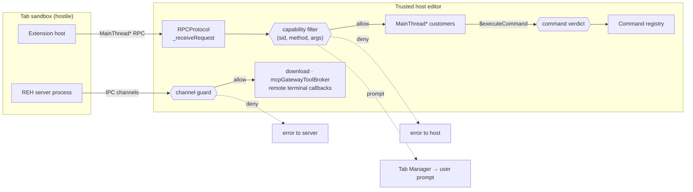

# RPC lockdown: containing the tab-to-host control channel

**Status:** design for review (Phase 2). Not implemented.
**Milestone:** M4.
**Upstream:** all permalinks pinned to `microsoft/vscode@a717861c07586a53d83b80d742cd3f59b20a6273`.
**Inventory this is built on:** [`rpc-filter/inventory/INVENTORY.md`](../rpc-filter/inventory/INVENTORY.md).
**Policy table:** [`rpc-filter/policy/policy.json`](../rpc-filter/policy/policy.json).

---

## 1. The problem, restated from code

A tab's sandbox contains the *code*. It does not contain the tab's ability to
**ask the trusted side to act on its behalf**. The sandbox is pointless if the
tab can ask the workbench to open a host terminal and type into it.

Three facts from the pinned source set the shape of the design.

**The dispatcher does not check the caller's location.**
[`RPCProtocol._doInvokeHandler`](https://github.com/microsoft/vscode/blob/a717861c07586a53d83b80d742cd3f59b20a6273/src/vs/workbench/services/extensions/common/rpcProtocol.ts#L449-L461)
resolves the target with `actor[methodName]` and checks only that it is a
function. There is no notion of where the caller runs, and no check against the
declared interface.

**The declared interface is not the boundary.** Because the lookup is
`actor[methodName]`, every `$` method on the registered instance is callable,
whether or not it appears in the `MainThread*Shape` interface. The inventory
finds 2 such methods today. Any review that reads only `extHost.protocol.ts`
misses them.

**The hostile party is the whole server, not just the extension host.** The REH
server process runs *inside* the tab. The client also registers channels *on*
that connection, which the server calls directly. Those never reach
`RPCProtocol` at all.

So the surface is four things, not one:

<!-- seclab:begin surface-counts -->
| | Surface | Size at this pin |
|---|---|---|
| (a) | `MainThread*` RPC the extension host calls | 89 services, 546 methods |
| (b) | The command registry reachable via `$executeCommand` | 3210 ids |
| (c) | Channels the client serves to the server, and server-initiated callbacks | 2 channels, 20 callback sites |
| (d) | Tab-supplied data the trusted side interprets with authority | 15 sink classes over 475 sites |
<!-- seclab:end surface-counts -->

## 2. Enforcement points

### 2.1 Why a choke point rather than per-class patches

The alternative is patching each dangerous `MainThread*` class. Rejected, from
code:

- It does not stay correct. There is no mechanism that notices a new service or
  method, so the patch set silently falls behind upstream. The project's whole
  cost model is the upstream bump.
- It scales badly in exactly the way the fork cannot afford: 89 files touched
  instead of 2, against the "one concern per patch, under ~50 lines" rule.
- It cannot see the undeclared methods, because those live on classes whose
  interface does not mention them.
- Each patch would re-derive "am I a sandboxed caller?" independently, so the
  rule would drift between call sites.

A single choke point keyed by `(sid, method)` fixes all four: one place that
knows the caller's identity, one table, and a build-time check that the table
covers the surface.

### 2.2 Primary choke point: the RPC dispatcher



The insertion is two core files.

`extensionHostManager.ts` constructs the protocol at
[L258](https://github.com/microsoft/vscode/blob/a717861c07586a53d83b80d742cd3f59b20a6273/src/vs/workbench/services/extensions/common/extensionHostManager.ts#L249-L270),
in a scope that already holds `this._extensionHost.remoteAuthority`. That is
where the per-tab identity is attached. This is the **only** construction site
outside tests, and it is on the single path taken for every `ExtensionHostKind`
including restart, so there is no second site and no pre-filter dispatch window.
That was confirmed in the design review.

Attachment must **fail closed**, which is a real trap: `remoteAuthority` is
`null` for local and worker hosts, so a filter resolved by authority alone is
fail-open by shape — an unexpected or unregistered authority yields "no filter"
rather than "deny". Instead:

```ts
// deny-all unless this host is either a known tab or the explicitly
// trusted local kind; an unknown seclab+ authority is fatal, not permissive.
const filter = seclabFilterFor(this._extensionHost.remoteAuthority, this.kind);
this._rpcProtocol = new RPCProtocol(protocol, logger, null, filter);
```

where `seclabFilterFor` throws if the authority matches `seclab+*` but the Tab
Manager registry has no entry for it, and returns a deny-all filter for any
authority that is neither a known tab nor the trusted local kind.

`rpcProtocol.ts` consults the filter in `_receiveRequest`, before
`_invokeHandler`, so the rejection path reuses the existing error reply and a
denied call is indistinguishable from an unsupported operation. The filter
rejects any method name that is not a `$` method, because `_doInvokeHandler`
will happily resolve inherited properties such as `constructor`; harmless
today, but the table must not have a hole shaped like "we only enumerated `$`
methods".

`rpcProtocol.ts` consults the filter in `_receiveRequest`, before
`_invokeHandler`, so the rejection path reuses the existing error reply and a
denied call is indistinguishable from an unsupported operation.

Three properties of this location matter and were chosen from code, not taste:

- **It is after URI transformation.** `_receiveOneMessage` applies
  `transformIncomingURIs` *before*
  [`_receiveRequest`](https://github.com/microsoft/vscode/blob/a717861c07586a53d83b80d742cd3f59b20a6273/src/vs/workbench/services/extensions/common/rpcProtocol.ts#L280-L307),
  so argument validators see the same revived URIs the handler will see. A
  validator placed earlier could be bypassed by a representation the
  transformer normalises differently.
- **It is before `actor[methodName]`.** So it covers undeclared methods too.
- **It is per extension host instance.** One `RPCProtocol` per host means the
  tab identity is captured once at construction and cannot be influenced later.

### 2.3 Keying: the wire `sid`, never the property name, never the `nid`

`createProxyIdentifier` assigns `nid` from module load order
([proxyIdentifier.ts L33-L50](https://github.com/microsoft/vscode/blob/a717861c07586a53d83b80d742cd3f59b20a6273/src/vs/workbench/services/extensions/common/proxyIdentifier.ts#L33-L50)),
so a `nid` is not stable across upstream bumps or even across a reordered
import. The filter resolves `getStringIdentifierForProxy(rpcId)` and keys on the
`sid` string.

The `sid` is **not** always the `MainContext` property name. The inventory finds
7 divergences, including `MainContext.MainThreadLanguageModelTools` travelling
as `'MainThreadChatSkills'` and `MainContext.MainThreadDialogs` as the
misspelled `'MainThreadDiaglogs'`. A table keyed on property names would simply
not match those, and the call would take whatever the default is. The drift
check rejects a policy key that is not a known `sid` by name, because this is a
failure mode that looks correct in review.

### 2.4 Second choke point: channels served to the server

A filter at `RPCProtocol` does not see surface (c) at all, because those
channels are registered on the remote connection, not on the RPC protocol. This
needs its own guard.

The obvious place is
[`AbstractRemoteAgentService.registerChannel`](https://github.com/microsoft/vscode/blob/a717861c07586a53d83b80d742cd3f59b20a6273/src/vs/workbench/services/remote/common/abstractRemoteAgentService.ts#L193-L195),
which is where both channels found today are registered. The design review
showed that is the wrong level: it is a thin convenience wrapper, and a holder
of the connection can register straight on the underlying `ChannelServer`, as
upstream already does elsewhere
([ipc.ts L1018-L1040](https://github.com/microsoft/vscode/blob/a717861c07586a53d83b80d742cd3f59b20a6273/src/vs/base/parts/ipc/common/ipc.ts#L1018-L1040)).
"One caller" is a convention; the mechanism is the invariant. So the guard goes
on `ChannelServer.registerChannel` / `IPCClient.registerChannel` for any client
whose context is a `seclab+*` remote connection, and each `call`/`listen` is
checked against the policy table before reaching the implementation.

The inventory scanner is correspondingly broadened to all `registerChannel(`
forms on a remote client, and an unresolvable receiver is a hard failure rather
than a skip — an invisible channel is not denied by default, because the guard
only exists where it was patched.

Both channels found today are denied outright:

- **`download`.** `DownloadServiceChannel` revives *both* URIs from
  server-supplied arguments
  ([downloadIpc.ts L18-L26](https://github.com/microsoft/vscode/blob/a717861c07586a53d83b80d742cd3f59b20a6273/src/vs/platform/download/common/downloadIpc.ts#L18-L26),
  registered at
  [remote.contribution.ts L77-L81](https://github.com/microsoft/vscode/blob/a717861c07586a53d83b80d742cd3f59b20a6273/src/vs/workbench/contrib/remote/common/remote.contribution.ts#L77-L81)).
  The trusted side will fetch a URL the tab picks, bypassing the broker, and
  write it to a host path the tab picks. Our REH arrives over `sbx exec` stdio
  and never needs the client to download for it.
- **`mcpGatewayToolBroker`.** Registered on the remote connection at
  [mcpGatewayToolBrokerContribution.ts L13-L21](https://github.com/microsoft/vscode/blob/a717861c07586a53d83b80d742cd3f59b20a6273/src/vs/workbench/contrib/mcp/browser/mcpGatewayToolBrokerContribution.ts#L13-L21),
  exposing `callToolForServer`, `readResourceForServer` and the list methods
  ([channel L167-L195](https://github.com/microsoft/vscode/blob/a717861c07586a53d83b80d742cd3f59b20a6273/src/vs/workbench/contrib/mcp/common/mcpGatewayToolBrokerChannel.ts#L167-L195)).
  `callToolForServer` invokes a **trusted-side** MCP tool with arguments the tab
  chooses. Host-side MCP servers are host processes holding host credentials, so
  this is a direct confused-deputy path to host code execution. This was found
  by the inventory scan and is not in the brief's list.

And the one server-initiated callback: `remoteTerminalBackend.onExecuteCommand`
([L102-L121](https://github.com/microsoft/vscode/blob/a717861c07586a53d83b80d742cd3f59b20a6273/src/vs/workbench/contrib/terminal/browser/remoteTerminalBackend.ts#L102-L121))
runs a command the server names, from a four-entry allowlist. The allowlist is a
stability measure, not a boundary: every entry on it is dangerous, and all four
are *also* ordinary registry commands reachable straight from `$executeCommand`
([mainThreadCLICommands.ts](https://github.com/microsoft/vscode/blob/a717861c07586a53d83b80d742cd3f59b20a6273/src/vs/workbench/api/browser/mainThreadCLICommands.ts#L29-L58)).
`_remoteCLI.openExternal` additionally passes `allowTunneling: true`.

### 2.5 Third choke point: `$executeCommand` arguments

`$executeCommand` is `allow_with_constraint`, and the constraint is that the id
argument must itself resolve to `allow` or `prompt` in the commands table. This
is an argument validator on one method, not a separate mechanism. An id the
table does not know is **denied**, not passed through: the scanner missing a
registration form must cost compatibility, never containment.

Two companion rules close the obvious ways around it:

- `$registerCommand` may not shadow an existing registry id, and ids a tab
  registers are namespaced and routed back only to that tab. This is necessary,
  not defensive: `CommandsRegistry.registerCommand` does `commands.unshift(...)`
  and `getCommand` returns the head
  ([commands.ts L99-L110](https://github.com/microsoft/vscode/blob/a717861c07586a53d83b80d742cd3f59b20a6273/src/vs/platform/commands/common/commands.ts#L99-L110)),
  so a later registration **wins over a built-in**. Without the rule a tab
  shadows a trusted id and gets invoked by the UI or by a `command:` link.
- `$getCommands` returns only ids this tab may execute, so the registry is not
  a reconnaissance oracle.

### 2.5.2 Taint: nested commands carry the tab identity

Checking only the command the tab *names* is not enough: its handler can execute
others, and those calls do not arrive from the tab. `_remoteCLI.windowOpen`
resolves `ICommandService` from its accessor and executes `_files.windowOpen`
([L35-L41](https://github.com/microsoft/vscode/blob/a717861c07586a53d83b80d742cd3f59b20a6273/src/vs/workbench/api/browser/mainThreadCLICommands.ts#L35-L41)).

The taint is propagated as a **capability, not ambient state**. A tab-originated
command is invoked through a child instantiation service whose `ICommandService`
binding is a tainted wrapper carrying the origin, so the handler's
`accessor.get(ICommandService)` returns it and every nested call is filtered
with the same table:

```ts
const tainted = new TaintedCommandService(this, origin);
const scoped = this._instantiationService.createChild(
    new ServiceCollection([ICommandService, tainted]));
return scoped.invokeFunction(command.handler, ...args);
```

This is the answer to "must survive async hops". There is **no
`AsyncLocalStorage`** available: the workbench renderer is a browser context,
and no use of `node:async_hooks` exists anywhere in `src/vs/workbench` or
`src/vs/platform`. Ambient taint is exactly what breaks across `await`,
`setTimeout` and event re-entry. A captured object reference does not break,
because it is not time-scoped at all.

Escapes fail closed: the global `CommandService` refuses any `deny` verdict
while a tab-originated command is in flight, and logs the attempt. The known
residual is a handler that uses a constructor-injected or imported command
service rather than its accessor; the backstop catches the denied subset.
Rationale and alternatives are in
[the ADR](adr/20261104-tab-command-taint.md).

### 2.5.3 The argument walker must match `marshalling.revive` exactly

`$executeCommand` revives its arguments with `revive()`, which bails at
`depth > 200` and turns `{$mid: MarshalledId.Regexp, source, flags}` into a live
`RegExp`
([marshalling.ts L44-L80](https://github.com/microsoft/vscode/blob/a717861c07586a53d83b80d742cd3f59b20a6273/src/vs/base/common/marshalling.ts#L44-L80)).

A validator that walks the argument graph differently is a bypass: a URI nested
at depth 201 is *not* revived, so a validator that revives everywhere sees a URI
where the consumer sees a plain object, and vice versa. The filter's walker
therefore shares code with `marshalling.revive`, including the depth cap, and
**rejects** any argument graph deeper than the cap rather than trying to match
its truncation behaviour. It also rejects `__proto__` as an own data property,
which `JSON.parse` in `deserializeRequestJSONArgs` will happily produce.

### 2.6 Surface (d): not calls, so not the RPC filter

Surface (d) is data the trusted side interprets with authority. It is listed in
the policy table with the mechanism that handles it, but the mechanisms are
separate patches: forcing `isTrusted=false` on markdown from a sandboxed host,
routing webview sessions through the tab broker, filtering
`IConfigurationInitData` to workspace scope, and turning password QuickInputs
into broker-held credentials returning a sentinel. These are named here so they
are not forgotten, and each gets its own patch and probe.

## 3. Policy as data

`policy/policy.json` carries, per surface:

| Field | Meaning |
|---|---|
| `verdict` | `allow`, `allow_with_constraint`, `prompt`, `rewrite`, `deny` |
| `capability` | what the caller gains |
| `impact` | worst case **with no filter at all** |
| `residual_impact` | what survives the verdict and constraint |
| `constraint` | the argument rule, for `allow_with_constraint` |
| `identity_from_argument` | the call takes an identity it should not be trusted for |
| `rationale`, `evidence` | why, and pinned permalinks |

Splitting `impact` from `residual_impact` is what makes the invariants
mechanically checkable. `$readFile`'s unmitigated impact genuinely includes
credential access through `vscode-userdata:`; its residual impact after the
scheme and authority constraint is empty. Without the split, the invariant check
either has to ignore constrained methods or forbid them, and both are wrong. An
entry may only claim reduced residual impact if it names a constraint.

The invariants the table is checked against, from `policy.json`:

<!-- seclab:begin invariants -->
1. **no-real-secret-in-tab** — No real secret may enter a tab, in any form, through any surface.
2. **identity-never-from-arguments** — Caller identity (tab, extension) is bound to the connection and is never read from call arguments.
3. **default-deny** — Any surface with no explicit verdict is denied.
4. **key-on-wire-sid** — RPC policy is keyed on the createProxyIdentifier sid string, never the MainContext property name and never the numeric nid.
5. **no-real-secret-in-tab.sentinel-derivation** — A token minted for the tab reaches it only as a sentinel, bound to no more than its parent's bindings, or to the bindings of a derivation rule the controller declared for that exact route.
6. **no-seclab-commands-from-tabs** — No command whose id begins 'seclab.' is reachable from a sandboxed host.
7. **every-deny-has-an-enforcement-point** — Every surface class carrying a deny verdict must name the code that refuses it, and that code must exist in the patch series.
8. **no-allowed-command-while-laundering-is-deferred** — No command may be given a verdict other than deny until the deferred-laundering residual is fixed.
9. **rpc-filter-log-is-trustworthy** — The filter's decision log may only be treated as trusted evidence while a tab can neither forge lines in it nor write the file.
<!-- seclab:end invariants -->

### 3.2 Categories may withhold authority; they may not grant it

The commands table groups ids into categories by substring. The first draft used
those categories to grant `allow` to 389 commands and `prompt` to 46. The design
review showed that is unsound, and the inventory agrees: the `editor-local`
category captured
`editor.action.accessibilityHelpOpenHelpLink`, which opens an external link, and
`_workbench.editor.configureDefaultEditor`, which matched `editor.` before the
underscore rule could deny it.

So the rule is now structural, and the drift check enforces it:

- A category rule may only carry `deny`.
- A command becomes reachable **only** through an explicit entry in
  `commands.exact`, reviewed against its implementation and carrying an impact
  assessment and evidence.
- The allowlist starts **empty**, by design. It is built from measured need in
  Phase 3: run a popular extension against the filter, observe the denial,
  review that command's implementation, then write an entry.

This drops the reachable set from 444 to **14**. That number is small because
nothing has been reviewed as safe yet, which is the honest state. The previous
444 was a measurement of how much had been written down, not of how much was
contained.

### 3.3 Per-tab identity

The filter's identity is `(tabId, remoteAuthority)`, resolved **once** at
`RPCProtocol` construction from `this._extensionHost.remoteAuthority`, and
mapped to a tab through the Tab Manager's registry, which gets it from the tab
supervisor (`seclab-tabd`). It is never parsed out of a call argument and never
re-read from anything the tab sends. The `identity_from_argument` flag exists
precisely to mark calls that violate this today.

`MainThreadSecretState` is the worst case. `$getPassword(extensionId, key)`,
`$setPassword`, `$deletePassword` and `$getKeys(extensionId)` all take the
extension identity **as an argument**
([L38-L80](https://github.com/microsoft/vscode/blob/a717861c07586a53d83b80d742cd3f59b20a6273/src/vs/workbench/api/browser/mainThreadSecretState.ts#L38-L80)),
and the stored key is `{extensionId, key}` globally
([L90-L92](https://github.com/microsoft/vscode/blob/a717861c07586a53d83b80d742cd3f59b20a6273/src/vs/workbench/api/browser/mainThreadSecretState.ts#L90-L92)).
So a hostile host names `vscode.github-authentication` and reads its stored
sessions, and `$getKeys` enumerates them first. The verdict is `rewrite`: the
argument is discarded, identity comes from the connection, and the key becomes
`{tabId, boundExtensionId, key}`, which fixes impersonation and cross-tab access
in the same change.

## 4. Default-deny and the drift check

Default-deny alone is not enough, because a surface that upstream *adds* would
be denied silently and the first symptom would be a broken extension nobody can
explain. The build-time check turns that into a reviewed decision.

`tools/check_drift.py` resolves every inventoried surface to a verdict and pins
the whole mapping by SHA-256 in `policy/coverage.json`. On an upstream bump the
inventory is regenerated; any new, changed or removed surface changes the digest
and **fails the build**, naming each one:

```
FAIL [coverage]
  the surface-to-verdict mapping changed since it was last reviewed.
    NEW       cmd:workbench.action.terminal.newLocalV2 -> deny
    NEW       rpc:MainThreadAgentEditorComments.$pwnNewUpstreamMethod -> deny
  Classify the new surfaces in policy.json, then re-run with --accept.
```

That output is from an actual run with a new method and a new command injected
into the inventory; it exits 1, and the clean tree exits 0.

Three checks run alongside coverage:

- **keys** — a policy entry whose key is not a real wire `sid`, or is the
  `MainContext` property name, is rejected by name. A `commands.exact` entry for
  a command the inventory does not contain is also rejected: that means the
  *scanner* missed a registration form, so sibling commands registered the same
  way are unclassified. This check found that
  `workbench.action.terminal.newLocal` was absent from a 2792-id scan because it
  is registered through `registerTerminalAction`; fixing the generator added
  413 commands.
- **undeclared** — every method callable via `actor[methodName]` without being
  declared in a Shape must have an explicit verdict.
- **invariants** — `no-real-secret-in-tab` and `identity-never-from-arguments`
  are evaluated across the **whole resolved mapping**, not only the entries
  someone chose to write. Any surface that resolves to a reachable verdict must
  have an individually reviewed entry carrying an impact assessment; a surface
  made reachable by a bulk rule fails the build.

Two properties of the digest matter:

- Reachable surfaces are pinned by a hash of their **whole policy entry**, not
  just the verdict. Otherwise weakening a `constraint` or adding
  `"residual_impact": []` leaves the digest unchanged, and a relabelling
  silently becomes a mitigation.
- The gate compares policy against a committed inventory, so CI must regenerate
  `inventory.json` from the source actually being built and fail on any diff.
  Without that, a generator that silently skips a directory produces a green
  build over a stale surface. **Open work**, noted in §7.

<!-- seclab:begin baseline -->
Current baseline at `a717861c0758`: **4223 surfaces, 4189 denied, 34 not denied** (14 allow, 9 allow_with_constraint, 4 prompt, 7 rewrite).
<!-- seclab:end baseline -->

### 4.1 What is reachable right now

<!-- seclab:begin reachable -->
Every surface below is reachable from a tab. Each one has an entry in
`policy/policy.json` with an impact assessment; the drift check fails if
any becomes reachable without one.

| Surface | Verdict |
|---|---|
| `data:mcp-server-definition` | rewrite |
| `data:quick-input-password` | rewrite |
| `data:terminal-osc-sequence` | allow_with_constraint |
| `data:uri-handler` | prompt |
| `data:webview-content` | allow_with_constraint |
| `data:workspace-configuration` | allow_with_constraint |
| `push:remoteFilesystem:fileChange` | allow |
| `push:remoteFilesystem:readFileStream` | allow |
| `push:remoteterminal:$onDidChangeProperty` | allow |
| `push:remoteterminal:$onDidRequestDetach` | allow |
| `push:remoteterminal:$onProcessDataEvent` | allow |
| `push:remoteterminal:$onProcessExitEvent` | allow |
| `push:remoteterminal:$onProcessOrphanQuestion` | allow |
| `push:remoteterminal:$onProcessReadyEvent` | allow |
| `push:remoteterminal:$onProcessReplayEvent` | allow |
| `push:remoteterminal:$onPtyHostExitEvent` | allow |
| `push:remoteterminal:$onPtyHostResponsiveEvent` | allow |
| `push:remoteterminal:$onPtyHostStartEvent` | allow |
| `push:remoteterminal:$onPtyHostUnresponsiveEvent` | allow |
| `rpc:MainThreadAuthentication.$getSession` | rewrite |
| `rpc:MainThreadClipboard.$writeText` | allow |
| `rpc:MainThreadCommands.$executeCommand` | allow_with_constraint |
| `rpc:MainThreadCommands.$getCommands` | allow_with_constraint |
| `rpc:MainThreadCommands.$registerCommand` | allow_with_constraint |
| `rpc:MainThreadCommands.$unregisterCommand` | allow_with_constraint |
| `rpc:MainThreadFileSystem.$readFile` | allow_with_constraint |
| `rpc:MainThreadFileSystem.$writeFile` | allow_with_constraint |
| `rpc:MainThreadSecretState.$deletePassword` | rewrite |
| `rpc:MainThreadSecretState.$getKeys` | rewrite |
| `rpc:MainThreadSecretState.$getPassword` | rewrite |
| `rpc:MainThreadSecretState.$setPassword` | rewrite |
| `rpc:MainThreadTunnelService.$openTunnel` | prompt |
| `rpc:MainThreadWindow.$asExternalUri` | prompt |
| `rpc:MainThreadWindow.$openUri` | prompt |
<!-- seclab:end reachable -->

## 5. Integration with the broker

`prompt` verdicts and the broker's hold-and-prompt path are the same UX and
should be the same mechanism, so the user sees one consistent "tab *foo* wants
…" dialog whether the request arrived over RPC or over the network.

- The filter raises a scope-expansion request through the Tab Manager, the same
  component that already handles the broker's "needs approval" events
  (ARCHITECTURE.md §4.2, §4.4).
- Requests carry the tab id from the supervisor, so prompts are tab-labelled and
  a decision is scoped to one tab.
- `rewrite` verdicts need the broker to be the other half: `$getSession` and
  password QuickInputs return a **sentinel**, and the broker swaps it for the
  real credential only on egress matching that credential's binding (§4.5).
  This is the mechanism that implements `no-real-secret-in-tab`.
- **Open item for the broker session:** the protocol for registering a
  user-typed password as a broker credential and minting its sentinel. Named in
  §7.

## 6. Fit with the patch queue

Expected core patches, each one concern, all small:

| Patch | Files | Rough size |
|---|---|---|
| RPC filter hook | `rpcProtocol.ts`, `extensionHostManager.ts` | ~30 lines |
| Channel guard | `abstractRemoteAgentService.ts` | ~25 lines |
| SecretStorage partitioning + identity rebinding | `mainThreadSecretState.ts` | ~20 lines |
| Auth sentinel | `mainThreadAuthentication.ts` | ~20 lines |
| Webview egress through the broker | webview service | ~30 lines |
| Config filtering for sandboxed hosts | `mainThreadConfiguration.ts` | ~25 lines |

The policy table, the inventory and the checks are **not** patches. They live in
`rpc-filter/` in this repo and are loaded as data, so upstream churn touches the
table rather than the diff. That is the property that makes the bump cheap: a
new upstream method is a JSON edit plus a review, not a rebase conflict.

## 6a. Surface (e): trusted-side AI surfaces are **not** covered by this filter

The chat agent runs in the **trusted workbench**, not in the tab. When it reads
a tab's files and invokes a trusted-side tool, **no RPC crosses the sandbox
boundary**, so the enforcement points in §2 never see it. A tab does not need a
confused deputy over RPC if it can write text that a trusted agent obeys:
`.github/instructions/` is located in workspace root folders, auto-attached
when `applyTo` is `**`, and the generated system prompt tells the model to
follow it.

**This filter does not contain that class, and nothing here should be read as
if it did.** For v0 the feature is **turned off** in `seclab+` windows
(patches 0009–0011, [ADR](adr/20261105-no-builtin-chat-in-tabs.md)) — a
withdrawal, not containment.

> **Two server-initiated push paths stay open on main (2026-11-06).** The REH
> can still reach the trusted side through `remoteTerminal`:
>
> * **`$onExecuteCommand`** — the server names a command and the workbench runs
>   it, against a four-entry `_remoteCLI` allow list. **Host code execution.**
> * **`$onPtyHostRequestResolveVariablesEvent`** — the server names strings the
>   workbench resolves over `shellEnvironmentService.getShellEnv()`, so
>   `${env:X}` returns the host user's shell environment. **Host credential
>   exfiltration**, and unlike the above it needs no live pty.
>
> Patches that refuse both exist, on the RPC-filter follow-up branch. They are
> **held back deliberately.** Both are rogue-REH surfaces, and the rogue-REH
> fixture has never been runnable: nothing applies its hook, so there is no
> runtime proof that either refusal works. A patch whose effect has never been
> observed is not containment, it is an untested claim, and this increment's
> scope is exactly what its probes demonstrate. Both are recorded as
> accepted-unenforced in `policy.json`, so the gate prints them on every run.
>
> They land once the attested containment build variant exists and each probe
> is shown going from succeeding on a baseline build to denied on a patched
> one.

> **The agent-host dial path is still open (2026-11-05).** Patch 0011, which
> closes it, is **not in this increment**. It is on a follow-up branch, held
> back so the core RPC filter can land first: host code execution from a tab
> via `workbench.action.terminal.newLocal` and `sendSequence` is reproducible
> on main today, and 0007/0008 close that. Until 0011 lands, a workspace
> setting can still make the host dial an attacker's agent host outside the
> broker. 0009 and 0010 are in this increment and are independent of it. The vulnerable architecture is unchanged; we have
stopped using it in tab windows. Containing it is a separate workstream.

The surface *is* enumerated and pinned by the drift gate, so a new tool or a
setting whose scope becomes tab-writable fails the build. But its probes are
**not implemented**: there is no runner, and **nothing has been proven against
an unpatched baseline**. Until that changes, surface (e) has an inventory and a
gate, and no evidence. Those are different things, and the probe registry says
`"status": "not-implemented"` for each so the suite cannot report them as
passes.

## 7. Residual risks

Stated plainly, because each one is a thing this design does **not** stop.
Numbers 1 to 4 came out of the independent design review
([`docs/security-reviews/20261104-rpc-lockdown-design.md`](security-reviews/20261104-rpc-lockdown-design.md)).

0. **Deferred laundering escapes the command taint.** A tab-originated handler
   that *defers* a global `ICommandService` call — `setTimeout`, an unawaited
   promise, an event subscription — runs after `seclabInFlight` has unwound, so
   it has neither an origin nor a non-zero counter and escapes both the taint
   and the backstop. The taint is scoped to the synchronous and awaited call
   tree, because the counter tracks the *call's duration* rather than the
   handler's lifetime; the candidate fix is to carry the origin in the
   invoker's disposable scope instead.

   This is safe only while every command verdict is `deny`: with nothing
   allowed, a laundered call is refused for being denied rather than for being
   laundered. That dependency is **checked, not described** —
   `check_drift.py::check_residuals` fails the build if any command is given a
   verdict other than `deny` while
   `residuals['deferred-laundering'].fixed` is false. Allowing a command is the
   obvious next compatibility fix, and nothing in review would otherwise
   connect it to this paragraph.

1. **Verdict laundering through nested commands.** Addressed by the command taint (§2.5.2, [ADR](adr/20261104-tab-command-taint.md)), but two escapes remain: a handler using a constructor-injected or imported `ICommandService` rather than its accessor, and services that run commands for a caller such as `IOpenerService` for `command:` URIs. The global-service backstop catches the denied subset; the allowed subset is unfiltered. Probed, not assumed.
2. **A verdict is pinned to an id, not to behaviour.** The digest covers policy
   entries and surface names. If upstream changes what an allowed command
   *does*, the mapping is byte-identical and the build passes. Candidate fix:
   extend each reachable entry with a hash of its defining source region, so an
   implementation change forces re-review of exactly the allowed surfaces.
3. **CI does not yet regenerate the inventory from the built source.** Until it
   does, a stale or under-scanning `inventory.json` yields a green gate over a
   surface that has grown. This is the highest-value piece of remaining
   tooling.
4. **The static command scan is still incomplete.** 168 id expressions remain
   unresolved and registration forms the regexes do not model will be missed.
   Default-deny makes each miss a compatibility cost rather than a containment
   hole, and the `keys` check turns a miss into a visible failure whenever
   someone writes a policy entry for the missing id — but nothing surfaces a
   miss nobody has noticed.
5. **Argument smuggling through revived URIs and
   `SerializableObjectWithBuffers`.** §2.5.1 constrains the walker to match
   `marshalling.revive`, but a scheme or authority check that disagrees with the
   eventual consumer's parsing is still a bypass. Needs differential testing,
   not review.
6. **The reachable set is small because nothing has been reviewed yet.** 14
   surfaces is not a claim of safety; it is a claim that we have not yet granted
   anything we did not look at. Phase 3 will grow it, and each addition is new
   risk.
7. **Clipboard write is allowed.** A tab can poison the clipboard so the user
   pastes attacker text into a host terminal. Accepted in v0.
8. **Surface (d) mechanisms are not the choke point.** Each is a separate patch
   with its own failure mode, and they are the least mature part of this design.
   The scan reports candidate sites, not verdicts, and will drift in precision.
9. **A denied call is a compatibility break**, surfacing as an error rather than
   a prompt. Which popular extensions this hits is unmeasured until Phase 3.

## 8. Decisions taken

All five are now settled; the design above reflects them.

1. **Verdict laundering: taint the command context.** The user's decision, in
   their words: *"anything a tab command triggers carries the tab's identity and
   goes through the filter."* Mechanism and alternatives in §2.5.2 and
   [the ADR](adr/20261104-tab-command-taint.md). Taint is carried as a
   capability rather than ambient state, because the renderer has no
   `AsyncLocalStorage`.
2. **Hard denial is the failure mode.** A denied call returns an error the
   extension sees as an unsupported operation. Prompting on first denial was
   rejected: it turns every rogue probe into a user decision, and users click
   through prompts. `prompt` stays a deliberate per-capability verdict, not a
   fallback.
3. **Clipboard write stays allowed for v0.** Read is denied. The residual is
   poisoning so the user pastes attacker text into a host terminal; a probe
   checks whether it chains into anything worse, and the decision is revisited
   if it does.
4. **Password inputs use the broker's `credential.import`.** A password
   QuickInput value is captured on the trusted side, imported into the broker as
   a user-supplied credential, and a tab-scoped sentinel is returned to the
   extension. Aligns with `docs/broker-protocol.md`.
5. **CI regenerates the inventory from the built source** and fails on any diff
   against the committed copy. Without this the gate compares policy to a
   committed artefact rather than to what is being built. Wiring it into the
   fork-build pipeline is tracked with that session.
