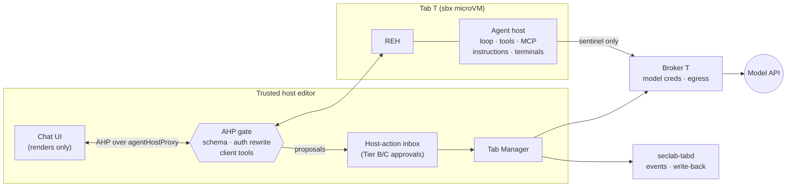

# Secure agentic experiences: chat and agents inside sandboxed tabs

- **Status:** proposed, design for review. Nothing here is built. ADR:
  [run agents inside the tab](../adr/20261105-agents-run-in-the-tab.md).
- **Date:** 2026-11-05
- **Owner:** secure-agentic-experiences session. Interfaces agreed with the RPC-lockdown,
  broker, fork-build and observability sessions are marked **[interface]**.
- **Upstream:** every permalink is pinned to `microsoft/vscode@a717861c07586a53d83b80d742cd3f59b20a6273`.
- **Evidence:** [agentic surfaces](../research/agentic-surfaces.md) (where everything runs
  today, with permalinks) and [prior art](../research/agentic-prior-art.md).
- **Review:** [security review](../security-reviews/20261105-secure-agentic-experiences-design.md).

The user's requests: "make a plan to move chat into sandboxed tabs", and "agentic
experiences are central to vscode, but we want to implement them securely with limited
blast radius".

---

## 0. Summary

**The idea.** An agent working on tab *T*'s workspace runs **inside tab *T***, with
exactly *T*'s authority. Its loop, its tools, its context gathering, its MCP servers and
its model calls all run in the tab. The trusted editor only renders it and carries the
user's words and decisions back. That turns "prompt injection steers a host-privileged
agent" into the problem this project already solves: a hostile workload in a tab. What
remains is a small, typed channel for the few things that must affect the host, and
every one of them goes through a trusted gate that already exists or is added here.

**The vehicle is upstream's own.** In a remote window, Code-OSS 1.145.0 already runs its
agent host on the remote machine: the REH spawns it and the workbench renders it over
the remote connection ([research §3.2](../research/agentic-surfaces.md#32-remote-windows-the-reh-hosts-it)).
For us the remote machine is the tab. We adopt that path and change three things about
it:

1. The workbench never sends a real credential into the tab. It sends broker sentinels,
   for resources chosen by trusted policy rather than by the tab (§4).
2. The workbench never runs a trusted-side tool because the tab asked. The client-tool
   set is empty, apart from a short list of reviewed safe outputs (§3.3, §5).
3. Everything the tab sends to the UI is checked against a schema and rendered as
   untrusted data (§3.4).

**Blast-radius tiers.** Tier A (default): the agent acts only inside the tab. Tier B:
host-affecting actions are structured proposals that trusted code validates and the
user approves. Tier C: opt-in grants that are scoped, time-boxed and revocable. Of the
54 trusted-side tools in the class (e) inventory, 28 keep working in the tab or are
re-implemented there, 7 become safe outputs, 17 are dropped and 2 are display adapters
(§5.4).

**What the user decides** is listed in §13. The recommended first spike is in §11.1.

## 1. The problem, restated from code

- **Today's built-in chat runs trusted-side and treats the workspace as authority.**
  Automatic instructions are read from the workspace and the system prompt tells the
  model to "follow the rules specified in it"
  ([computeAutomaticInstructions.ts#L368-L377](https://github.com/microsoft/vscode/blob/a717861c07586a53d83b80d742cd3f59b20a6273/src/vs/workbench/contrib/chat/common/promptSyntax/computeAutomaticInstructions.ts#L368-L377)).
  Many tools run on the host even in a remote window: browser and Playwright, page fetch,
  extension install, session and automation tools
  ([research §4.2](../research/agentic-surfaces.md#42-built-in-tools-by-host-effect-in-a-tab-window)).
  A tab only has to write a file to steer a host-privileged agent, and no RPC crosses
  the boundary.
- **`runsInWorkspace` does not place anything.** Its only consumer chooses which settings
  layers may auto-approve a tool
  ([languageModelToolsService.ts#L1414-L1460](https://github.com/microsoft/vscode/blob/a717861c07586a53d83b80d742cd3f59b20a6273/src/vs/workbench/contrib/chat/browser/tools/languageModelToolsService.ts#L1414-L1460)).
  No tool declares it `true`. A plan cannot rely on it, and must never set it `true` on
  a tool that can reach the host, because `true` admits tab-written settings (§2, I5).
- **The tab writes most settings.** Remote user settings are read from a path the REH
  supplies, with every scope except `APPLICATION`, so `chat.tools.global.autoApprove`
  (`APPLICATION_MACHINE`) is tab-writable
  ([research §11](../research/agentic-surfaces.md#11-settings-a-tab-controls)).
- **The upstream remote agent-host path leaks credentials.** The tab's agent host names
  the protected resources and scopes, and the workbench forwards a real token, silently,
  over a client→server call that no existing filter sees
  ([research §12](../research/agentic-surfaces.md#12-credentials)). The same applies to
  MCP OAuth.
- **v0 is a withdrawal, not containment.** Patch 0009 (RPC-lockdown session) refuses tool
  registration, tool invocation and `sendRequest` in `seclab+` windows; the null
  agent-host service for tab windows is being added to close the auth push. The design
  below is how to turn agents back on.

**Which attacker.** Two, and the design treats them differently:

| | Adversary | What it controls | Defence that carries the argument |
|---|---|---|---|
| **R** | A rogue extension (primary threat model) | The whole tab: REH, agent host, model traffic, any label or event produced in the tab | Containment. Nothing in the tab is believed; only trusted-side gates count |
| **W** | Hostile content steering an honest agent: workspace files, instructions, web pages, tool output, MCP responses | What the agent reads | Containment first (it can do no more than R), then in-tab defences that lower the odds: provenance labels, instruction policy, approvals for egress |

Anything W can achieve, R can achieve directly. So no Tier A control may rely on the
agent behaving; in-tab defences are for W only and are called defence in depth.

## 2. Invariants

1. **I1. No trusted-side agent over tab content.** No trusted-side model call has
   tab-controlled content in its context while it can call a tool with host effect. Tab
   content can reach a trusted-side model only through a quarantined call with no tools,
   whose output is data (§8.2).
2. **I2. Tools run in the tab.** Every tool an agent for tab *T* can call runs in *T*, or
   is a safe output that trusted code validates and applies (§5).
3. **I3. No real secret enters a tab** (existing ADR). Model and MCP credentials reach
   the agent only as sentinels. The workbench never forwards a token into a tab, and the
   tab never chooses the resource or scopes a credential is resolved for.
4. **I4. Tab output is hostile to the renderer.** Everything from the tab's agent host is
   schema-validated and rendered as untrusted: no trusted markdown, no command links, no
   HTML, and URIs limited to the tab's own authority (§3.4).
5. **I5. Only trusted inputs set policy.** Trusted inputs are: what the user types or
   clicks in trusted UI, `APPLICATION`-scope settings, the trusted profile on the host,
   product data and code. Workspace files, remote user settings, tool output and anything
   produced in the tab are data.
6. **I6. One agent, one tab.** No agent, tool, session or context spans tabs. Cross-tab
   views are trusted-side code over structured data (§8).
7. **I7. Approvals are trusted, labelled, exact and scarce.** An approval is rendered by
   trusted code, names the tab from tabd, shows the effect from validated structured
   fields, binds the decision to a digest of that effect, and cannot be raised at will by
   the tab (§9).

## 3. Placement

### 3.1 Decision: the upstream agent host, spawned by the tab's REH

| Option | Verdict | Why |
|---|---|---|
| **A. Upstream agent host in the tab** (REH default mode, workbench `EditorRemoteAgentHostServiceClient`) | **Recommended** | Upstream already places it in the remote ([serverServices.ts#L253-L395](https://github.com/microsoft/vscode/blob/a717861c07586a53d83b80d742cd3f59b20a6273/src/vs/server/node/serverServices.ts#L253-L395), [agentHostService.ts#L49-L57](https://github.com/microsoft/vscode/blob/a717861c07586a53d83b80d742cd3f59b20a6273/src/vs/workbench/services/agentHost/electron-browser/agentHostService.ts#L49-L57)). The loop, provider SDK, terminals, MCP and instruction discovery all run in the tab with no new code. AHP is a generated, versioned protocol with a registry of methods, so it can be inventoried and gated like the RPC surface. It is where upstream is investing (multi-harness; 1.138 and 1.139 release notes) |
| B. Extension-hosted chat participants in the tab (e.g. a Copilot or Open VSX chat extension) | Later, as a compatibility tier | The loop is already in the tab, but rendering needs `MainThreadChatAgents2`, `MainThreadChatSessions` and `MainThreadLanguageModelTools` re-opened under a progress filter, and its core tools (`runInTerminal`, `runSubagent`) are workbench tools invoked through `vscode.lm.invokeTool` ([research §2.1](../research/agentic-surfaces.md#21-extension-hosted-participants-classic-chat)). Two surfaces to gate instead of one |
| C. Our own agent | Rejected | A parallel stack the project would have to maintain against a fast-moving upstream; no advantage over A |
| D. Trusted-side agent with tab-side tools only (dual LLM over tab content) | Rejected for tab work | The trusted context would hold tab content, which violates I1 unless the privileged model never sees it, at which point the useful agent is the one in the tab. Kept only for global, metadata-only questions (§8.2) |

The agent host's `@github/copilot-sdk` runtime is a prebuilt binary
([research §14](../research/agentic-surfaces.md#14-supply-chain)). It runs in the tab, so
it is contained, but it needs a provenance decision (§13, D3). The Claude and Codex
harnesses have the same shape.

### 3.2 What crosses the boundary

Everything below travels over the REH's `agentHostProxy` channel and passes the AHP gate
(§3.3). Anything not listed is denied.

**Trusted UI → tab**

| Item | Rule |
|---|---|
| User prompt, follow-ups, cancel, model and agent selection | As typed or chosen in trusted UI |
| Attachments | Tab resources only (`vscode-remote://seclab+<self>/…`); a host file is never attached to a tab agent |
| Decisions on in-tab permission requests | UX inside the tab, not a security gate (the tab can approve itself); sent as the user chose |
| Configuration | An allowlist of `APPLICATION`-scope settings the agent host consumes (for example edit auto-approve patterns, [chat.shared.contribution.ts#L900-L913](https://github.com/microsoft/vscode/blob/a717861c07586a53d83b80d742cd3f59b20a6273/src/vs/workbench/contrib/chat/browser/chat.shared.contribution.ts#L900-L913)); nothing else |
| `authenticate` | **Sentinel only**, for a resource in the trusted provider table, never for what the tab named (§4.2) |
| MCP authentication | Same rule; grants keyed by tab (§4.4) |
| Environment for the agent-host process | Only the resolver's `extensionHostEnv`, which the Tab Manager controls ([serverServices.ts#L378-L388](https://github.com/microsoft/vscode/blob/a717861c07586a53d83b80d742cd3f59b20a6273/src/vs/server/node/serverServices.ts#L378-L388)) |
| Client proxy, Kerberos, client certificates | Off. Upstream gates them to WSL and container remotes ([#L141](https://github.com/microsoft/vscode/blob/a717861c07586a53d83b80d742cd3f59b20a6273/src/vs/workbench/services/agentHost/browser/editorRemoteAgentHostServiceClient.ts#L141)); the gate pins them off for `seclab+` |
| `createTcpConnection` (the client opens TCP on the tab's network) | Tier C only: a host browser view of a tab's dev server |

**Tab → trusted UI**

| Item | Rule |
|---|---|
| Session, chat and turn state, markdown, tool-call display, plans, usage | Schema-validated, size-capped, rendered untrusted (§3.4) |
| Terminal output | Rendered as terminal text; OSC and link handling as for any tab terminal |
| Changesets and diffs | Of tab files only; the write-back gate decides what reaches the host |
| Permission requests for in-tab tools | Inline in the transcript, labelled as the tab asking itself |
| Protected-resource requests | Handled by the auth rewrite (§4.2); never a prompt by default |
| `ToolClientExecution` requests | Refused, except the safe-output allowlist (§5.2) |
| Safe-output proposals (Tier B/C) | Sent to the host-action inbox, never executed inline (§5) |
| Resource-watch and annotation URIs | Tab authority only |
| OTLP and telemetry channels | Dropped |

### 3.3 The AHP gate

A third choke point, alongside the RPC filter and the channel guard, at the one place a
tab's agent host reaches the workbench: the transport that
`EditorRemoteAgentHostServiceClient` builds over `agentHostProxy`
([editorRemoteAgentHostServiceClient.ts#L116-L160](https://github.com/microsoft/vscode/blob/a717861c07586a53d83b80d742cd3f59b20a6273/src/vs/workbench/services/agentHost/browser/editorRemoteAgentHostServiceClient.ts#L116-L160)).

- **Placement.** One patch wraps the transport when the remote authority is `seclab+*`.
  The identity is the window's authority, resolved once at construction, as for the RPC
  filter. An unknown `seclab+` authority gets no agent host at all.
- **Inbound (tab → UI).** Each message is validated against the generated AHP schema for
  the negotiated version before the protocol client sees it. Unknown methods, action
  types, fields and channels are dropped and reported. Strings are size-capped. The
  channels and action types the UI accepts are an allowlist in policy data.
- **Outbound (UI → tab).** `authenticate` is rewritten (§4.2). `ToolClientExecution`
  results are produced only for allowlisted safe outputs. The client capabilities the UI
  advertises in `initialize` are pinned: no client tools except the allowlist, no client
  proxy, no client certificates.
- **Policy as data, with a drift check.** AHP has roughly 48 methods and 108 action types
  at this pin, generated from one registry
  ([commands.ts#L10-L17](https://github.com/microsoft/vscode/blob/a717861c07586a53d83b80d742cd3f59b20a6273/src/vs/platform/agentHost/common/state/protocol/commands.ts#L10-L17)).
  The spike generates the exact inventory. As in `rpc-filter/`, the verdicts live in a
  table, every surface has a verdict, and the build fails on an unclassified one.
  **[interface: RPC-lockdown session]**, which owns the inventory tooling; proposed as a
  new class (f), "agent-host protocol", in the same generator.

### 3.4 Rendering hostile content

Everything in §3.2's second table is rendered by trusted code, so the renderer is in
scope:

- markdown from the tab is always `isTrusted: false` and `supportHtml: false`, with no
  theme icons or command links: the RPC-LOCKDOWN surface (d) rule, extended to AHP
  content;
- links render as text plus an explicit "open" affordance that goes through the
  `$openUri` prompt path (tab-labelled), never a direct open;
- no command buttons from tab content; anything that runs a command is trusted UI
  generated from a validated safe output;
- bidi controls, zero-width characters and over-long strings are stripped or capped in
  every field shown in trusted chrome (titles, tool names, approval text), reusing the
  broker's `untrusted` sanitiser rules ([ADR](../adr/20261104-broker-output-is-data.md));
- tab content never renders in the regions where trusted approvals and labels appear
  (§9.3).

Residual: a logic bug in the chat renderer is reachable from the tab (R5 in §12).

## 4. Model and credential access

### 4.1 Decision: model calls stay in the tab, through the broker

The agent host calls the model API from inside the tab, through the tab's broker, with
sentinel credentials. The alternative, trusted-side model calls on the tab's behalf
(`vscode.lm` style), was already rejected by the broker and RPC-lockdown sessions: it
gives the tab a credentialed channel outside its broker, with the prompt as an unbounded
field ([ADR broker output is data](../adr/20261104-broker-output-is-data.md), decision 4).
Keeping it in the tab gives per-tab quota, rate limits and audit at one choke point we
already own.

### 4.2 The `authenticate` rewrite

Upstream resolves a session for whatever the agent host advertises and forwards its
access token ([agentHostAuth.ts#L895-L951](https://github.com/microsoft/vscode/blob/a717861c07586a53d83b80d742cd3f59b20a6273/src/vs/workbench/contrib/chat/browser/agentSessions/agentHost/agentHostAuth.ts#L895-L951)).
In a `seclab+` window the gate replaces that with:

1. Match the advertised `resource` against a **trusted provider table** (product data,
   `APPLICATION` scope). Each entry fixes the auth provider, the scopes and the broker
   binding. The tab's `scopes_supported` and `authorization_servers` are ignored.
2. On the first request per tab, ask once: "Tab *foo* wants to use your GitHub account
   for Copilot", labelled as for any RPC-filter `prompt`.
3. Resolve the real session trusted-side, import it into the tab's broker with the
   table's binding (`credential.import`), and get a tab-scoped sentinel back.
4. Send the sentinel in `authenticate`. Unknown resources get an empty token, logged.

**[interface: broker session]** For the Copilot harness this needs:

- a GitHub credential bound to `GET api.github.com/copilot_internal/v2/token`, injected
  as `Authorization: token …`, which is the extension's own call shape
  ([copilotTokenManager.ts#L250-L262](https://github.com/microsoft/vscode/blob/a717861c07586a53d83b80d742cd3f59b20a6273/extensions/copilot/src/platform/authentication/node/copilotTokenManager.ts#L250-L262));
  the runtime's exact call is confirmed in the spike;
- the minted Copilot token re-sentinelised as a derived credential. Today a derived
  credential inherits exactly its parent's bindings, but the Copilot token is used on
  different hosts (the Copilot API hosts). **Proposed:** the provider table declares the
  derivation (parent binding → child binding on a fixed host list), so the widening is
  trusted data and never taken from the response's `endpoints` field. That is a broker
  policy change (§13, D7);
- whether the Copilot runtime honours the tab's proxy and CA is unmeasured (spike §11.1).

BYOK keys follow the same path: imported to the broker, bound to the provider's host and
path, a sentinel in the tab.

### 4.3 Quota, rate and audit **[interface: broker, observability]**

- Per-tab request and byte budgets on model hosts, enforced by the broker; a tab over
  budget is denied, not prompted. Token counts from responses may only restrict.
- Model calls are audit events with `integrity: trusted` (broker-produced): host, path,
  sizes and status, never bodies.
- A rogue extension can spend the user's model quota up to the tab's budget. Accepted and
  bounded (R1).

### 4.4 MCP

- Workspace stdio MCP servers run in the tab under the agent host. Allowed in Tier A.
- Host (user-level) MCP servers are host processes with host credentials. They are not
  reachable from a tab agent (`mcpGatewayToolBroker` stays denied). A specific one can be
  offered as a Tier C grant through an interceptor (the Docker MCP gateway pattern).
- MCP OAuth for tab agents uses the §4.2 rewrite. Upstream keys remembered grants with an
  empty agent-host authority
  ([agentHostChatContribution.ts#L228-L231](https://github.com/microsoft/vscode/blob/a717861c07586a53d83b80d742cd3f59b20a6273/src/vs/workbench/contrib/chat/browser/agentSessions/agentHost/agentHostChatContribution.ts#L228-L231));
  we key them by tab, and nothing is silent.
- MCP tool responses are untrusted input (gh-aw's distinction, prior art §2).

## 5. Blast-radius tiers

### 5.1 Tier A: the agent acts only inside the tab (default)

- **Tools:** everything the agent host runs in the tab: shell and tasks on the tab pty,
  file edits in the tab, workspace MCP, fetch and browser in the tab through the broker,
  subagents.
- **In-tab approvals are UX.** The tab can approve itself, so they protect against W, not
  R. The default permission level inside a tab can be high (§13, D5), because the blast
  radius is the tab.
- **Host effects, all through existing gates:** edits reach the host checkout only
  through the write-back gate (code-running files held, including `.github/**`,
  `AGENTS.md` and `.mcp.json`); egress only through the broker (default-deny, prompts,
  sentinels bound by host, path and method); RPC only through the filter.
- **Lethal trifecta.** Private data: the workspace and sentinel-bound credentials.
  Untrusted content: yes. External channel: broker egress, default-deny with prompts and
  path-bound credentials. The leg we narrow is the channel.

### 5.2 Tier B: safe outputs

Host-affecting actions are **proposals**: structured, schema-validated objects that
trusted code applies after the user approves the exact effect. This is gh-aw's
SafeOutputs pattern (prior art §2). Most of what an agent might want already has a
trusted gate, so Tier B mostly routes agent requests into those gates:

| Safe output | Applied by | Notes |
|---|---|---|
| `openExternal(url)` | RPC-filter `prompt` path (`$openUri`) | Tab-labelled, URL shown encoded |
| `egress(host[, path, method])` | Broker approval | Literal suggestion only (broker ADR) |
| `reviewWriteBack()` | Write-back review in the Tab Manager | The agent marks the request; the user opens the review. Fork commands stay denied to tabs |
| `installExtension(id)` | Extension management, into this tab only | The approval names the tab |
| `confirm(...)` (the three confirmation tools) | Inline card | Rate-limited; never modal |
| `setArtifacts(...)`, `setArtifactRules(...)`, `getThemeColors()` | Display only | Tab-scoped |

Rules for every safe output:

- a closed enum of types, each with a JSON schema and size caps; anything else is
  rejected;
- the effect shown to the user is rendered from validated fields; the agent's free-text
  reason is shown separately and quoted as untrusted;
- the decision is bound to a digest of the validated effect and a single-use nonce;
- proposals queue in a per-tab **host-action inbox** (§9). They never open a modal by
  themselves.

### 5.3 Tier C: grants

Opt-in, per-capability, time-boxed and revocable. Each grant is data held by tabd or the
broker, shown in the status bar while active, and expires on its own:

| Grant | Example | Mechanism |
|---|---|---|
| Egress scope | `*.npmjs.org` for this session | Broker rule with an expiry |
| Extra mount | A read-only reference folder | tabd mount (needs a restart under Docker) |
| Host view of a tab service | Integrated browser on the tab's `:3000` | AHP `createTcpConnection` or a tunnel, through the broker |
| One host MCP server | A specific user-level server | Gateway with interceptors; secrets scoped to that server |

**Never grantable:** a host shell or terminal, host file writes outside the write-back
gate, another tab, a real secret, `APPLICATION` settings.

### 5.4 Classification of every trusted-side tool

Source: the class (e) inventory (54 tools). **Keep in tab**: the function already runs in
the tab under the agent host. **Re-implement in tab**: the host version is dropped and an
equivalent runs in the tab. **Safe output**: Tier B. **Drop**: not offered to tab agents.

Rows marked "host browser" are re-implemented as a headless browser or a Playwright MCP
server inside the tab, with egress through the broker. A host browser view of a page the
tab serves is a Tier C grant.

| Tool | Declared in | Class | Notes |
|---|---|---|---|
| [`click_element`](https://github.com/microsoft/vscode/blob/a717861c07586a53d83b80d742cd3f59b20a6273/src/vs/workbench/contrib/browserView/electron-browser/tools/clickBrowserTool.ts#L13) | electron-browser | re-implement in tab | Host browser |
| [`create_and_run_task`](https://github.com/microsoft/vscode/blob/a717861c07586a53d83b80d742cd3f59b20a6273/src/vs/workbench/contrib/terminalContrib/chatAgentTools/browser/tools/task/createAndRunTaskTool.ts#L268) | browser | keep in tab | The agent host runs tasks in the tab. Classic path: remote task backend; probe A10 |
| [`definition.id` (expression)](https://github.com/microsoft/vscode/blob/a717861c07586a53d83b80d742cd3f59b20a6273/src/vs/workbench/api/browser/mainThreadLanguageModelTools.ts#L128) | browser | keep in tab | Extension tools run in the registering host. Allowed only when that host is this tab (provenance from the connection, not the tool name) |
| [`drag_element`](https://github.com/microsoft/vscode/blob/a717861c07586a53d83b80d742cd3f59b20a6273/src/vs/workbench/contrib/browserView/electron-browser/tools/dragElementTool.ts#L13) | electron-browser | re-implement in tab | Host browser |
| [`entry?.data.id ?? 'mcpApp.tool.…'` (expression)](https://github.com/microsoft/vscode/blob/a717861c07586a53d83b80d742cd3f59b20a6273/src/vs/workbench/contrib/chat/browser/agentSessions/agentHost/agentHostMcpAppToolsService.ts#L254) | browser | drop | MCP app UI tools render in the workbench; revisit with webview egress (M4) |
| [`get_task_output`](https://github.com/microsoft/vscode/blob/a717861c07586a53d83b80d742cd3f59b20a6273/src/vs/workbench/contrib/terminalContrib/chatAgentTools/browser/tools/task/getTaskOutputTool.ts#L19) | browser | keep in tab | Tasks run in the tab |
| [`get_terminal_output`](https://github.com/microsoft/vscode/blob/a717861c07586a53d83b80d742cd3f59b20a6273/src/vs/workbench/contrib/terminalContrib/chatAgentTools/browser/tools/getTerminalOutputTool.ts#L15) | browser | keep in tab | Tab pty only |
| [`handle_dialog`](https://github.com/microsoft/vscode/blob/a717861c07586a53d83b80d742cd3f59b20a6273/src/vs/workbench/contrib/browserView/electron-browser/tools/handleDialogBrowserTool.ts#L13) | electron-browser | re-implement in tab | Host browser |
| [`hover_element`](https://github.com/microsoft/vscode/blob/a717861c07586a53d83b80d742cd3f59b20a6273/src/vs/workbench/contrib/browserView/electron-browser/tools/hoverElementTool.ts#L13) | electron-browser | re-implement in tab | Host browser |
| [`kill_terminal`](https://github.com/microsoft/vscode/blob/a717861c07586a53d83b80d742cd3f59b20a6273/src/vs/workbench/contrib/terminalContrib/chatAgentTools/browser/tools/killTerminalTool.ts#L11) | browser | keep in tab | Tab pty only |
| [`list_browser_pages`](https://github.com/microsoft/vscode/blob/a717861c07586a53d83b80d742cd3f59b20a6273/src/vs/workbench/contrib/browserView/electron-browser/tools/listBrowserPagesTool.ts#L11) | electron-browser | re-implement in tab | Host browser |
| [`navigate_page`](https://github.com/microsoft/vscode/blob/a717861c07586a53d83b80d742cd3f59b20a6273/src/vs/workbench/contrib/browserView/electron-browser/tools/navigateBrowserTool.ts#L16) | electron-browser | re-implement in tab | Host browser |
| [`open_browser_page`](https://github.com/microsoft/vscode/blob/a717861c07586a53d83b80d742cd3f59b20a6273/src/vs/workbench/contrib/browserView/electron-browser/tools/openBrowserTool.ts#L33) | electron-browser | re-implement in tab | Host browser |
| [`progress.toolName` (expression)](https://github.com/microsoft/vscode/blob/a717861c07586a53d83b80d742cd3f59b20a6273/src/vs/workbench/contrib/chat/common/model/chatModel.ts#L1271) | common | n/a (adapter) | Display of a participant's tool call |
| [`rawTool.name` (expression)](https://github.com/microsoft/vscode/blob/a717861c07586a53d83b80d742cd3f59b20a6273/src/vs/workbench/contrib/chat/common/tools/languageModelToolsContribution.ts#L317) | common | keep in tab | Extension-contributed tools from `package.json`; same rule as `definition.id` |
| [`read_page`](https://github.com/microsoft/vscode/blob/a717861c07586a53d83b80d742cd3f59b20a6273/src/vs/workbench/contrib/browserView/electron-browser/tools/readBrowserTool.ts#L13) | electron-browser | re-implement in tab | Host browser |
| [`run_playwright_code`](https://github.com/microsoft/vscode/blob/a717861c07586a53d83b80d742cd3f59b20a6273/src/vs/workbench/contrib/browserView/electron-browser/tools/runPlaywrightCodeTool.ts#L13) | electron-browser | re-implement in tab | Host browser; today it runs code in a host browser session |
| [`run_task`](https://github.com/microsoft/vscode/blob/a717861c07586a53d83b80d742cd3f59b20a6273/src/vs/workbench/contrib/terminalContrib/chatAgentTools/browser/tools/task/runTaskTool.ts#L164) | browser | keep in tab | Tasks run in the tab |
| [`runSubagent`](https://github.com/microsoft/vscode/blob/a717861c07586a53d83b80d742cd3f59b20a6273/src/vs/workbench/contrib/chat/common/tools/builtinTools/runSubagentTool.ts#L136) | common | keep in tab | Agent-host subagents run in the tab |
| [`screenshot_page`](https://github.com/microsoft/vscode/blob/a717861c07586a53d83b80d742cd3f59b20a6273/src/vs/workbench/contrib/browserView/electron-browser/tools/screenshotBrowserTool.ts#L27) | electron-browser | re-implement in tab | Host browser |
| [`send_to_terminal`](https://github.com/microsoft/vscode/blob/a717861c07586a53d83b80d742cd3f59b20a6273/src/vs/workbench/contrib/terminalContrib/chatAgentTools/browser/tools/sendToTerminalTool.ts#L23) | browser | keep in tab | Tab pty only; never a local terminal |
| [`setArtifactRules`](https://github.com/microsoft/vscode/blob/a717861c07586a53d83b80d742cd3f59b20a6273/src/vs/workbench/contrib/chat/common/tools/builtinTools/setArtifactRulesTool.ts#L52) | common | safe output | Display only, tab-scoped, schema-validated |
| [`setArtifacts`](https://github.com/microsoft/vscode/blob/a717861c07586a53d83b80d742cd3f59b20a6273/src/vs/workbench/contrib/chat/common/tools/builtinTools/setArtifactsTool.ts#L54) | common | safe output | Display only, tab-scoped, schema-validated |
| [`task_complete`](https://github.com/microsoft/vscode/blob/a717861c07586a53d83b80d742cd3f59b20a6273/src/vs/workbench/contrib/chat/common/tools/builtinTools/taskCompleteTool.ts#L23) | common | keep in tab | Session state only |
| [`tc.toolName` (expression)](https://github.com/microsoft/vscode/blob/a717861c07586a53d83b80d742cd3f59b20a6273/src/vs/workbench/contrib/chat/browser/agentSessions/agentHost/stateToProgressAdapter.ts#L2483) | browser | n/a (adapter) | Display of an agent-host tool call |
| [`terminal_last_command`](https://github.com/microsoft/vscode/blob/a717861c07586a53d83b80d742cd3f59b20a6273/src/vs/workbench/contrib/terminalContrib/chatAgentTools/browser/tools/getTerminalLastCommandTool.ts#L12) | browser | keep in tab | Tab pty only |
| [`terminal_selection`](https://github.com/microsoft/vscode/blob/a717861c07586a53d83b80d742cd3f59b20a6273/src/vs/workbench/contrib/terminalContrib/chatAgentTools/browser/tools/getTerminalSelectionTool.ts#L11) | browser | keep in tab | Selection in a tab terminal only |
| [`tool.id` (expression)](https://github.com/microsoft/vscode/blob/a717861c07586a53d83b80d742cd3f59b20a6273/src/vs/workbench/contrib/mcp/common/mcpLanguageModelToolContribution.ts#L138) | common | keep in tab | MCP tools run where the server runs: workspace servers in the tab. Host MCP servers are dropped for tab agents (§4.4) |
| [`type_in_page`](https://github.com/microsoft/vscode/blob/a717861c07586a53d83b80d742cd3f59b20a6273/src/vs/workbench/contrib/browserView/electron-browser/tools/typeBrowserTool.ts#L16) | electron-browser | re-implement in tab | Host browser |
| [`vscode_completeAttemptComparison`](https://github.com/microsoft/vscode/blob/a717861c07586a53d83b80d742cd3f59b20a6273/src/vs/sessions/contrib/sessionComparison/browser/sessionComparisonTool.ts#L181) | browser | drop | Cross-session |
| [`vscode_configureAutomation`](https://github.com/microsoft/vscode/blob/a717861c07586a53d83b80d742cd3f59b20a6273/src/vs/sessions/contrib/automations/browser/automationTools.ts#L488) | browser | drop | Durable host-side control plane |
| [`vscode_create_remote_session`](https://github.com/microsoft/vscode/blob/a717861c07586a53d83b80d742cd3f59b20a6273/src/vs/sessions/contrib/remoteSessions/browser/remoteSessionTools.ts#L54) | browser | drop | Starts work on another agent host |
| [`vscode_deleteAutomation`](https://github.com/microsoft/vscode/blob/a717861c07586a53d83b80d742cd3f59b20a6273/src/vs/sessions/contrib/automations/browser/automationTools.ts#L360) | browser | drop | Durable host-side control plane |
| [`vscode_editFile_internal`](https://github.com/microsoft/vscode/blob/a717861c07586a53d83b80d742cd3f59b20a6273/src/vs/workbench/contrib/chat/common/tools/builtinTools/editFileTool.ts#L18) | common | re-implement in tab | The agent host edits in the tab. Classic path: URI constrained to this tab's authority |
| [`vscode_fetchWebPage_internal`](https://github.com/microsoft/vscode/blob/a717861c07586a53d83b80d742cd3f59b20a6273/src/vs/workbench/contrib/chat/electron-browser/builtInTools/fetchPageTool.ts#L26) | electron-browser | re-implement in tab | The host fetch bypasses the broker and reads host `file:`. In the tab: fetch through the broker |
| [`vscode_get_confirmation`](https://github.com/microsoft/vscode/blob/a717861c07586a53d83b80d742cd3f59b20a6273/src/vs/workbench/contrib/chat/common/tools/builtinTools/confirmationTool.ts#L14) | common | safe output | Inline, origin-labelled, rate-limited card; never a modal |
| [`vscode_get_confirmation_with_options`](https://github.com/microsoft/vscode/blob/a717861c07586a53d83b80d742cd3f59b20a6273/src/vs/workbench/contrib/chat/common/tools/builtinTools/confirmationTool.ts#L45) | common | safe output | Same as `vscode_get_confirmation` |
| [`vscode_get_modified_files_confirmation`](https://github.com/microsoft/vscode/blob/a717861c07586a53d83b80d742cd3f59b20a6273/src/vs/workbench/contrib/chat/common/tools/builtinTools/confirmationTool.ts#L72) | common | safe output | Same; the files are tab files |
| [`vscode_get_remote_session`](https://github.com/microsoft/vscode/blob/a717861c07586a53d83b80d742cd3f59b20a6273/src/vs/sessions/contrib/remoteSessions/browser/getRemoteSessionTool.ts#L23) | browser | drop | Reads another session |
| [`vscode_get_terminal_confirmation`](https://github.com/microsoft/vscode/blob/a717861c07586a53d83b80d742cd3f59b20a6273/src/vs/workbench/contrib/terminalContrib/chatAgentTools/browser/tools/runInTerminalConfirmationTool.ts#L11) | browser | keep in tab | In-tab confirmation, rendered as tab-origin |
| [`vscode_getThemeColors`](https://github.com/microsoft/vscode/blob/a717861c07586a53d83b80d742cd3f59b20a6273/src/vs/sessions/contrib/chat/browser/getThemeColorsTool.ts#L58) | browser | safe output | Read-only, non-sensitive trusted data |
| [`vscode_installExtensions`](https://github.com/microsoft/vscode/blob/a717861c07586a53d83b80d742cd3f59b20a6273/src/vs/workbench/contrib/extensions/common/installExtensionsTool.ts#L12) | common | safe output | Into this tab only, after an approval that names the tab; never local |
| [`vscode_list_agent_hosts`](https://github.com/microsoft/vscode/blob/a717861c07586a53d83b80d742cd3f59b20a6273/src/vs/sessions/contrib/remoteSessions/browser/remoteSessionTools.ts#L17) | browser | drop | Enumerates hosts |
| [`vscode_listAutomations`](https://github.com/microsoft/vscode/blob/a717861c07586a53d83b80d742cd3f59b20a6273/src/vs/sessions/contrib/automations/browser/automationTools.ts#L125) | browser | drop | Reads host automations |
| [`vscode_organizeSessionsList`](https://github.com/microsoft/vscode/blob/a717861c07586a53d83b80d742cd3f59b20a6273/src/vs/sessions/contrib/sessions/browser/sessionsListTools.ts#L198) | browser | drop | Cross-session |
| [`vscode_readAttemptComparison`](https://github.com/microsoft/vscode/blob/a717861c07586a53d83b80d742cd3f59b20a6273/src/vs/sessions/contrib/sessionComparison/browser/sessionComparisonTool.ts#L54) | browser | drop | Cross-session |
| [`vscode_readSessionsList`](https://github.com/microsoft/vscode/blob/a717861c07586a53d83b80d742cd3f59b20a6273/src/vs/sessions/contrib/sessions/browser/sessionsListTools.ts#L111) | browser | drop | Cross-session |
| [`vscode_reportCustomizationMigration`](https://github.com/microsoft/vscode/blob/a717861c07586a53d83b80d742cd3f59b20a6273/src/vs/workbench/contrib/chat/browser/aiCustomization/customizationMigrationResultTool.ts#L70) | browser | drop | Not needed in a tab |
| [`vscode_resolveDebugEventDetails_internal`](https://github.com/microsoft/vscode/blob/a717861c07586a53d83b80d742cd3f59b20a6273/src/vs/workbench/contrib/chat/common/tools/builtinTools/resolveDebugEventDetailsTool.ts#L10) | common | drop | Reads chat debug events, possibly of other sessions; revisit |
| [`vscode_runAutomation`](https://github.com/microsoft/vscode/blob/a717861c07586a53d83b80d742cd3f59b20a6273/src/vs/sessions/contrib/automations/browser/automationTools.ts#L236) | browser | drop | Starts host-side agent work |
| [`vscode_screenshotWindow`](https://github.com/microsoft/vscode/blob/a717861c07586a53d83b80d742cd3f59b20a6273/src/vs/sessions/contrib/chat/browser/screenshotWindowTool.ts#L39) | browser | drop | Captures trusted UI, including other content |
| [`vscode_searchExtensions_internal`](https://github.com/microsoft/vscode/blob/a717861c07586a53d83b80d742cd3f59b20a6273/src/vs/workbench/contrib/extensions/common/searchExtensionsTool.ts#L14) | common | re-implement in tab | A gallery query with agent-chosen text from the host network is an exfiltration channel; query from the tab via the broker |
| [`vscode_send_remote_message`](https://github.com/microsoft/vscode/blob/a717861c07586a53d83b80d742cd3f59b20a6273/src/vs/sessions/contrib/remoteSessions/browser/sendRemoteMessageTool.ts#L24) | browser | drop | Drives another session |
| [`vscode_setChatBackground`](https://github.com/microsoft/vscode/blob/a717861c07586a53d83b80d742cd3f59b20a6273/src/vs/sessions/contrib/chat/browser/chatBackgroundTool.ts#L76) | browser | drop | Lets the agent restyle trusted chrome (spoofing) |

Totals: keep in tab 14, re-implement in tab 14, safe output 7, drop 17, adapter 2 (54).
"Keep in tab" assumes the agent-host path; under the classic path the terminal and task
rows depend on probe A10.

## 6. Prompt-injection defences beyond containment

These address adversary W (§1). R bypasses them by construction, so none of them carries
the containment argument.

### 6.1 Provenance labels

- **Trusted side: coarse and enforced.** Everything from tab *T*'s agent host is "tab *T*
  data". It is the only label the trusted side can believe, and the AHP gate attaches it
  from the connection, never from content.
- **In the tab: fine-grained and advisory.** Context items carry their source
  (user-typed, trusted profile, workspace instruction, workspace file, tool output, MCP
  response, web, model output), and untrusted ones are wrapped with spotlighting-style
  delimiters (prior art §5). This needs agent-host and SDK support; we propose it
  upstream (U4) rather than patch closed runtimes.
- The chat UI shows the user's attachments and the instructions in effect as chips with
  their source, so the user can see when workspace instructions are steering the agent.

### 6.2 Trusted instructions versus workspace instructions

- **Trusted:** the user's own instructions and prompt files in the trusted profile on the
  host, and `APPLICATION` settings. They are sent into the tab session as user
  instructions; they then become visible to the tab, so forwarding is opt-in (§13, D9).
- **Workspace instructions** (`AGENTS.md`, `.github/copilot-instructions.md`,
  `.github/instructions/`, `CLAUDE.md`, prompt and agent files, skills) are data. On
  first use per tab, the UI shows "This workspace gives the agent instructions" with the
  files listed, and lets the user accept them as project conventions or not. The decision
  is stored host-side per tab.
- Enforcement is in-tab, so against R it is advisory. The write-back gate already stops a
  tab from planting these files in the host checkout unreviewed, which is what matters
  for the next tab and for other tools on the host.

### 6.3 Plan-then-execute for host-affecting actions

- **Tier B and C already have the property that matters.** The set of possible host
  effects is a closed enum chosen by trusted code, and the user approves the exact
  validated effect. Untrusted content can choose arguments, not actions. That is the
  action-selector pattern, on the trusted side.
- **Arguments are the residual** (prior art §5). Mitigations: literal-only suggestions (as
  in the broker), encoded display, and a nonce per decision.
- **Optional, later:** for an autopilot mode that applies Tier B outputs without a click,
  require a plan declared at the start of the turn, before tool output arrives, and reject
  proposals outside it. This is a light form of CaMeL; it needs agent-host support and is
  not in v1.

### 6.4 Confirmations

Every host-boundary confirmation shows: the tab (from tabd, in trusted chrome), the
session, the action type (from the closed enum), the exact effect (from validated fields,
encoded, capped), and the agent's stated reason, quoted and marked as from the tab.
Buttons are specific ("Allow egress to `registry.npmjs.org` for 1 hour"), never "Yes".

## 7. Composition with existing controls

| Control | How agents use it |
|---|---|
| RPC capability filter | Unchanged. `MainThreadChatAgents2`, `MainThreadLanguageModels`, tools and chat sessions stay denied to tabs in Tier A. The agent path does not use `MainThread*` |
| Channel guard | Unchanged. `mcpGatewayToolBroker` stays denied |
| Command taint | Anything a tab's AHP content causes the UI to run carries the tab's identity. In practice nothing, because tab content cannot produce command links or buttons (§3.4) |
| AHP gate (new) | Schema, auth rewrite, client tools, capabilities (§3.3) |
| Broker | Model and MCP credentials as sentinels; quota; egress prompts; derived Copilot token (§4) |
| Write-back gate | Agent edits to code-running files are held like any tab write. **Proposed:** attribute agent-session writes so the review can say "written by the agent in session *S*" (advisory, tab-produced) |
| Tab observability | Agent events (§7.1), with a new integrity label for events the tab's agent host reports |
| Secret scan | Unchanged. It runs before mount, so the agent never sees a pre-existing secret |
| Tab-scoped secrets and sessions | Agent-host state (`agent-host.db`) lives in the tab and is cleared by Reset tab. Trusted-side caches are keyed by tab |

### 7.1 Agent events **[interface: observability session]**

| Event | Producer | Integrity |
|---|---|---|
| Agent host connected or refused; AHP gate denials | AHP gate (workbench, through the existing trusted report path) | `trusted` |
| Credential requested, resolved, denied | AHP gate and broker | `trusted` |
| Model call (host, sizes, status) | Broker | `trusted` |
| Safe output proposed, approved, denied, applied | Inbox and Tab Manager | `trusted` |
| Session, turn, tool call (name, argument digest) | The tab's agent host | **new: `tab-reported`**, weaker than `tab-vm-root` because tab user space produces it |

The process tree under the agent host is already visible to the sbx collector
(`tab-vm-root`), so a tool call that runs a shell shows up there too.

## 8. Multi-tab and global agents

### 8.1 One agent, one tab

- Each tab's REH spawns its own agent host; nothing is shared. The chat view in a tab
  window shows only that tab's sessions.
- The sessions list and the Agents window aggregate across agent hosts. For `seclab+`
  hosts they are disabled until a per-tab presentation exists, and no cross-session tools
  are offered (§5.4 drops them).
- The **local agent host** (an Electron utility process with the user's environment,
  [electronAgentHostStarter.ts#L206-L227](https://github.com/microsoft/vscode/blob/a717861c07586a53d83b80d742cd3f59b20a6273/src/vs/platform/agentHost/electron-main/electronAgentHostStarter.ts#L206-L227))
  is disabled in the fork. It is a host-privileged agent and could be pointed at the host
  checkout behind a tab.

### 8.2 Global chat with no workspace

- A folder-less window already gets an ephemeral, empty tab (ARCHITECTURE §4.2). Global
  chat is the agent in that empty tab: the same machinery, with nothing of the user's
  mounted.
- Questions about the user's tabs ("which tab is calling `example.com`?") are answered by
  trusted-side code over structured data: tabd events, broker audit, the tab list. If an
  LLM summarises tab events, it is a **quarantined** call: no tools, tab strings in a
  data-only section (broker ADR rule), and output rendered as data. That is the only
  trusted-side model call in the design, and it never acts.

## 9. UX

### 9.1 What the user sees

- The same chat panel. The header says "Agent · Tab *foo*" in trusted chrome. Tool calls
  inside the tab run without host prompts.
- A per-tab **host-action inbox** (a badge on the tab's status item) collects Tier B and C
  proposals, credential first-use asks, and egress prompts the agent triggered.
- The "Tab activity" view gains agent events (§7.1).

### 9.2 Approval fatigue and floods

- In-tab actions need no host approval, which removes most prompts.
- Host-boundary requests queue in the inbox; nothing the tab sends opens a modal.
- Per-tab limits: a cap on pending proposals (further ones are auto-denied and logged),
  backoff on repeats, and "deny everything from this session".
- Decisions are reusable only at their stated scope ("this tab", "this hour"), never
  globally.
- The fork's own commands stay denied to tabs, so a tab cannot raise review dialogs at
  will (RPC-lockdown commit `ed5fe56`).

### 9.3 Spoofing

- Approvals and labels render in trusted chrome outside the transcript. Transcript content
  from the tab cannot draw there or restyle it (`vscode_setChatBackground` is dropped).
- The tab name comes from tabd. The agent's text never appears in a button label.

## 10. Upstream alignment

**What we reuse:** the agent host and AHP; the REH's default lazy agent-host mode; the
workbench's remote agent-host client and renderer; upstream's provider harnesses.

**Patches (each one concern, under about 50 lines), proposed:**

| Patch | Where | Purpose |
|---|---|---|
| AHP gate hook | `editorRemoteAgentHostServiceClient.ts`, transport construction | Wrap the transport for `seclab+`; the policy is data |
| Auth rewrite | `agentHostChatContribution.ts` `_authenticateIfCurrent` and the MCP handler | Route `authenticate` through the gate's broker exchange |
| No local agent host | `agentHostService.ts` (electron-browser) | Null service for local and folder-less windows |
| Client capabilities | `agentHostActiveClientService.ts` `_getClientTools` | Empty client tool set for `seclab+`, plus the safe-output allowlist |

The v0 null agent-host service in tab windows (RPC-lockdown session) is replaced by the
gate hook when Tier A ships.

**Upstream proposals (drafts only; never filed without the user):**

- **U1. Brokered credentials for remote agent hosts.** A workbench extension point that
  lets a remote resolver supply a credential broker. Tokens are never forwarded to an
  untrusted remote by default, and the remote never chooses scopes.
- **U2. Client tools per connection.** An empty client-tool set by default for remotes
  the resolver marks untrusted.
- **U3. `runsInWorkspace` semantics.** Document that it chooses settings layers, not
  placement, and add a separate "may affect the host" flag that remote settings can
  never auto-approve.
- **U4. Instruction trust levels** in the agent host: workspace instructions as labelled
  data, with prompt wording to match.
- **U5. MCP grants keyed by agent-host authority** rather than an empty authority.

## 11. Phases, exit criteria and probes

### 11.1 Recommended first spike: an agent host in a tab, rendered, with no credential

**Goal:** measure, not ship. Find out from evidence what the trusted client does with a
hostile agent host.

1. Build a test-only REH and a client harness (in containers only). The REH runs in an
   sbx tab in its default agent-host mode. The agent host talks to a **fake model
   endpoint**: a local beacon fixture reached through the tab's broker, using a sentinel.
   No real credential exists anywhere.
2. Generate the AHP inventory (methods, action types, channels, client capabilities) from
   `protocol/version/registry.ts` with the RPC-lockdown generator, as class (f).
3. Write a **rogue agent host** fixture (inert, nonce-armed, markers under `.work/`) that
   advertises arbitrary protected resources and scopes, requests client-tool execution
   for every advertised tool, sends markdown with command links, HTML and bidi text,
   sends non-tab URIs, and opens TCP channels.
4. Drive the real workbench client code against it at the protocol level in a node
   container, with no editor window. Where a window is unavoidable, launch it in the
   background and tear it down at once.
5. Measure whether the Copilot runtime honours the tab's proxy variables and CA.

**Output:** an EDR with the inventory and the results, and a first draft of the AHP
policy table. **Exit:** probes A1, A3, A4, A5 and A7 below have measured outcomes against
an ungated client (expected to fail) and a gated prototype (expected to pass).

### 11.2 Phases

| Phase | Scope | Exit criteria |
|---|---|---|
| 0 (now) | v0: built-in chat and tools off in tab windows (0009); null agent-host service in tab windows (RPC-lockdown) | A1, A6 and A12 pass against v0 |
| 1 | Spike §11.1 | EDR, inventory, policy draft |
| 2 | Tier A: AHP gate, auth rewrite with broker sentinels, local agent host off, rendering hardening, agent events | Every Tier A probe passes on sbx and OCI; security review with no open high or critical |
| 3 | Tier B: safe outputs and the inbox | Tier B probes; review |
| 4 | Tier C: grants | Tier C probes; review |
| 5 | Optional compatibility tier for extension-hosted participants (`MainThreadChatAgents2` under a progress filter) | The same probes against a rogue participant; review |

### 11.3 Probes that must pass before each tier is enabled

All of them run against our own builds, with inert fixtures and full teardown.

**Tier A**

| # | Probe | Pass condition |
|---|---|---|
| A1 | A rogue agent host advertises arbitrary `protectedResources` and scopes | Unknown resources get an empty token; known ones only a sentinel; real-token canaries never appear in tab memory, environment, disk or traffic |
| A2 | MCP OAuth request from the tab | No silent token; the grant is keyed by tab; sentinel only |
| A3 | `ToolClientExecution` for every workbench tool | Refused except the allowlist; a `trusted` gate event per refusal |
| A4 | Markdown with `command:` links, HTML, theme icons, bidi and zero-width text, oversized strings | Rendered inert; nothing runs; trusted chrome is unaffected |
| A5 | AHP URIs outside the tab's authority (resource watch, attachments, links, file system provider) | Never read, opened or watched by the client |
| A6 | The tab writes remote user settings (`chat.tools.global.autoApprove`, `chat.disableAIFeatures`, terminal rules) | No trusted-side gate changes behaviour |
| A7 | `createTcpConnection` and port forwarding without a grant | Refused |
| A8 | Tab A's agent host addresses tab B's sessions | Not possible; each window lists only its own tab |
| A9 | Model call paths | Only through the tab's broker; direct egress fails at the fence; the per-tab budget is enforced |
| A10 | The agent runs a terminal command or a task | The marker appears in the tab, not on the host |
| A11 | Proposal and prompt flood | The inbox stays bounded; no modal; the excess is auto-denied and logged |
| A12 | Local agent host | No agent-host utility process on the host while tabs are open, including in folder-less windows |
| A13 | The agent writes `.github/copilot-instructions.md`, `AGENTS.md`, `tasks.json` or a hook | Held by the write-back gate |
| A14 | An unknown AHP method or action type | Dropped and reported; the drift check fails the build on an unclassified one |
| A15 | Teardown | Nothing left behind (harness EDR) |

**Tier B:** B1, schema fuzzing of every safe-output type. B2, replaying a decision with a
stale nonce or a changed effect fails. B3, the displayed effect matches the applied effect
byte for byte. B4, bidi and homoglyph text in every displayed field is neutralised.

**Tier C:** C1, expiry. C2, revocation takes effect on the next request. C3, the tab
cannot widen a grant. C4, the never-grantable list is enforced in code, not only in the
UI.

## 12. Residual-risk register

| # | Risk | Severity after controls | Disposition |
|---|---|---|---|
| R1 | A rogue extension drives the tab's agent and spends the user's model quota | Low | Accepted; per-tab budget |
| R2 | Workspace content goes to the model provider | By design | The user chose the provider |
| R3 | An honest agent steered by workspace content (W) damages the tab's workspace, and ordinary edits sync to the host checkout | Medium | Code-running files are held; ordinary source is not. **Option:** hold all agent-attributed writes for review (§13, D8) |
| R4 | An honest agent pushes injected code to GitHub with the user's sentinel-bound credential | Medium | Push bindings require a per-tab prompt (broker); revisit with downscoped tokens |
| R5 | Logic bugs in the trusted chat renderer reachable from tab content | Medium | Schema validation, untrusted markdown; renderer 0-days are out of scope |
| R6 | Social engineering: agent text persuades the user to paste a command into a host terminal (clipboard write is allowed in v0) | Medium | Labels; no "run on host" affordances; accepted as in RPC-lockdown decision 3 |
| R7 | Approval fatigue in Tier B and C | Medium | Inbox, limits, scoped decisions |
| R8 | AHP churn: a large, fast-moving protocol | Medium | Generated inventory and drift check |
| R9 | An opaque prebuilt Copilot runtime inside tabs | Low (contained) | Supply-chain exception or an alternative (§13, D3) |
| R10 | A derived Copilot token bound to hosts other than its parent's | Low | A fixed host list from trusted data (§4.2) |
| R11 | In-tab labels and instruction policy are bypassed by R | n/a | By design; containment carries the argument |
| R12 | Global chat cannot see host files | UX cost | Accepted; a mount into the empty tab is a Tier C grant |
| R13 | The classic extension-hosted path (Phase 5) has a second, larger rendering surface | Medium | Deferred; separate review |

## 13. Decisions for the user

1. **D1. Vehicle:** the upstream agent host in the tab (recommended); extension-hosted
   chat participants only as a later compatibility tier.
2. **D2. Model access:** in the tab, through the broker with sentinels (recommended); not
   trusted-side mediated calls.
3. **D3. Copilot runtime in tabs:** `@github/copilot-sdk` (MIT-labelled) ships a prebuilt
   `copilot-runtime` binary. Options: an exception EDR (it only ever runs inside tabs);
   only harnesses we can build from source; or BYOK with an open-source harness.
4. **D4. Workspace instructions:** data with a per-tab acceptance (recommended), ignored,
   or authority as upstream.
5. **D5. Default in-tab approval level:** auto-approve in-tab tools (recommended; the tab
   is the blast radius), or upstream's default.
6. **D6. Global chat:** the agent in an empty tab, with the local agent host and the
   Agents window disabled (recommended).
7. **D7. Derived Copilot token:** bound to the Copilot API hosts through the trusted
   provider table. This is a broker policy change for the broker session.
8. **D8. Agent writes to ordinary files:** sync as today (recommended for v1), or hold
   agent-attributed writes for review.
9. **D9. Forwarding the user's own trusted-profile instructions into tabs:** opt-in
   (recommended), or on by default.

## 14. Coordination

| Session | Ask |
|---|---|
| RPC-lockdown | Null agent-host service in tab windows (raised); `tab_writable = scope != APPLICATION` in class (e); AHP as class (f) in the inventory generator; the shape of the AHP gate policy |
| Broker | The provider table and trusted derivation rule (D7); per-tab model budgets; `credential.import` from the AHP gate |
| Fork-build | The §10 patches after review; local agent host off; supply-chain decision D3 and register entries for the agent SDKs in the REH |
| Observability | The `tab-reported` integrity label and the agent event classes (§7.1) |
